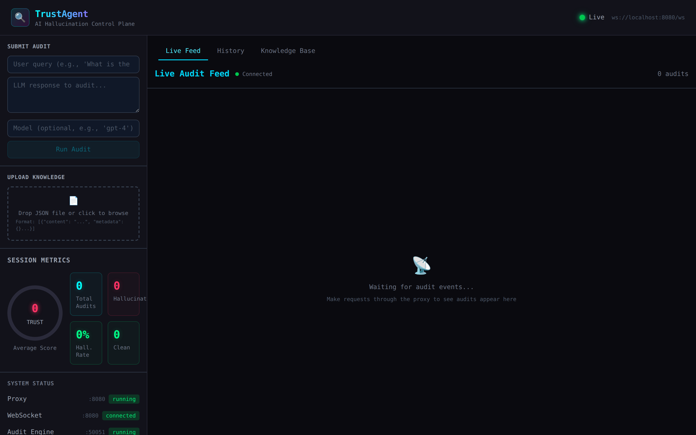
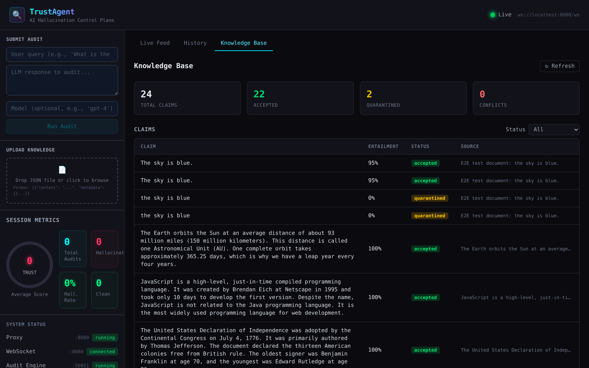

<div align="center">

# TrustAgent

### A hallucination gateway for LLM apps

**Point your OpenAI or Anthropic SDK at it. Every answer is checked against the documents your request already carries, then passed, flagged, blocked or replaced with a grounded one by your policy, and audited claim by claim on a live dashboard.**

[](https://github.com/timkush1/TrustAgent/actions/workflows/ci-go.yml)
[](https://github.com/timkush1/TrustAgent/actions/workflows/ci-python.yml)
[](https://github.com/timkush1/TrustAgent/actions/workflows/ci-web.yml)
[](https://github.com/timkush1/TrustAgent/actions/workflows/ci-e2e.yml)
[](https://github.com/timkush1/TrustAgent/actions/workflows/security.yml)


</div>

---

## Table of Contents

- [What it is](#what-it-is)
- [How it works](#how-it-works)
- [Quick start](#quick-start)
- [Use it from your app](#use-it-from-your-app)
- [The checks](#the-checks)
- [Screenshots](#screenshots)
- [Tech stack](#tech-stack)
- [Configuration](#configuration)
- [Testing and evaluation](#testing-and-evaluation)
- [Observability](#observability)
- [Security](#security)
- [Project structure](#project-structure)
- [Documentation](#documentation)
- [Roadmap](#roadmap)
- [Honest limitations](#honest-limitations)
- [License](#license)

---

## What it is

Large language models state falsehoods with total confidence. **TrustAgent** is a gateway that
sits between your app and the model and checks every answer before your user acts on it.

Your app keeps its SDK and changes one line, the base URL. For each answer, TrustAgent runs
deterministic detectors, then asks **Jev** (TypeSafe AI's fast decision model) all of the route's
checks as questions in **one** call, and applies your policy: **observe** (measure only),
**flag** (headers tell your app the risk), **block** (a safe message instead) or **fallback**
(a second answer written only from your documents, checked again). A **deep audit** then
verifies the answer claim by claim with an LLM judge, off the request path, and streams to the
dashboard.

Evidence is **pluggable, with no RAG by default**: TrustAgent checks against what the request
already carries (documents in the system prompt, a `Context:` block, tool results, or the
`trustagent.context` extension). With nothing to check against, it says **not checked** instead
of guessing. A verified knowledge base is an optional add-on.

## How it works

```
  Your app (OpenAI / Anthropic SDK)        TrustAgent gateway (Go)                  LLM API
          │                                        │                                   │
          │── POST /v1/chat/completions ──────────▶│──────── forward request ────────▶│
          │                                        │◀─────────── answer ──────────────│
          │                                        │
          │                          Tier 0: detectors (numbers, dates, URLs, quotes,
          │                                  citations, secrets, prompt leaks)
          │                          Tier 1: fast check, every evaluator in ONE Jev call
          │                          Policy: observe | flag | block | fallback (re-gated)
          │◀── answer + X-TrustAgent-* headers ────│
          │                                        ├──▶ deep-audit job (async, sampled)
          │                                        │        │ gRPC
          │                                        │        ▼
          │                                        │   Tier 2: Python engine (LangGraph)
          │                                        │   decompose → [retrieve] → verify → score
          │          Dashboard ◀── WebSocket v2 ◀──┘
```

Observe routes never wait: the answer goes out byte-identical and the check runs after it. Flag,
block and fallback routes decide before they answer, within the route's deadline (600 ms by
default); what happens when the check is slow or down is set per route
([docs/GATEWAY.md](docs/GATEWAY.md#6-when-something-fails)).

## Quick start

**Prerequisites:** Docker with Compose 2.24+, `make` and `python3`. On Windows, use WSL 2 with
Docker Desktop's WSL integration ([docs/GETTING-STARTED.md](docs/GETTING-STARTED.md) walks
through it).

### 1. The zero-key demo ($0, everything simulated)

```bash
make demo
```

It builds the images, starts the demo stack (proxy, engine, Postgres, dashboard and a scripted
traffic generator) as its own Docker project, waits until every part is healthy, then opens the
one-time **setup link** that creates your admin key (or the dashboard at
<http://localhost:3000> when an admin already exists; `OPEN=0` only prints the URL).

The fast check and the judge are mocks and no vendor key reaches the containers, so every number
on screen is **simulated** and labelled that way. The traffic generator replays 26 scripted
scenarios: grounded answers that pass, a contradicted refund window that is flagged, a leaked
email address, an invented link that is blocked, a payments answer replaced by a grounded
fallback, streams, and the Anthropic API.

```bash
make doctor ARGS="--expect demo"   # checks every part: health, fast check, calibration, policy, metrics
make demo-setup-url                # a new one-time setup link, if you need one
make demo-down                     # stop (make demo-clean also deletes the demo data)
```

### 2. Real mode (your own OpenRouter key)

One OpenRouter key runs both the fast check (Jev) and the deep-audit judge (Claude Haiku). With
the shipped defaults that costs about $3 per 1,000 answers **[estimate]**, under daily caps of $2
for fast checks and $5 for deep audits. [docs/JEV-ACCESS.md](docs/JEV-ACCESS.md) has the steps
and the costs.

```bash
echo 'OPENROUTER_API_KEY=sk-or-v1-...' >> .env   # .env is gitignored
make up                                          # proxy, engine, Postgres, dashboard; opens the setup link
make doctor                                      # shows the fast-check backend, why it was chosen, snapshot, latency and cost
```

## Use it from your app

```python
from openai import OpenAI

client = OpenAI(
    base_url="http://localhost:8080/v1",                  # TrustAgent instead of the provider
    api_key="sk-...",                                      # your provider key, passed through
    default_headers={
        "X-TrustAgent-Key": "<a key from TRUTHTABLE_API_KEYS>",
        "X-TrustAgent-Route": "support-bot",               # which policy route applies
    },
)
reply = client.chat.completions.with_raw_response.create(
    model="gpt-4o-mini",
    messages=[
        {"role": "system", "content": "<document>Annual plans: refund within 30 days.</document>"},
        {"role": "user", "content": "Can I get a refund after 45 days?"},
    ],
)
print(reply.headers["X-TrustAgent-Action"], reply.headers.get("X-TrustAgent-Reasons"))
```

`/v1/chat/completions`, `/v1/completions` and `/v1/messages` (Anthropic) are gated, JSON and
streaming. Streams carry the decision as an SSE comment and HTTP trailers, or through
`GET /v1/trustagent/decisions/:trace_id`. Headers, modes, streaming, block and fallback bodies,
errors and credentials are in [docs/GATEWAY.md](docs/GATEWAY.md); policies live in
[`config/policies.yaml`](config/policies.yaml) and on the dashboard's **Policies** page.

## The checks

| Tier | Where | What it does |
|---|---|---|
| **0. Detectors** | Go, in the gateway (budget: under 2 ms) | Numbers, dates, URLs, quotes and citations that are not in the evidence; secret patterns; system-prompt leaks. Numbers and dates never flag alone. |
| **1. Fast check (Jev)** | One Jev call per answer | Every evaluator of the route as a question: groundedness, contradiction, unapproved commitments, PII or secret leaks, prompt-injection success, refusals, off-topic, off-brand tone, ... ([docs/EVALUATORS.md](docs/EVALUATORS.md)). Blocks only when two signals agree. |
| **2. Deep audit** | Python engine, async | Decomposes the answer into claims (with UTF-16 spans the dashboard marks), verifies each against the evidence with an LLM judge, and scores it. |

The deep audit is a [LangGraph](https://github.com/langchain-ai/langgraph) state machine:

| Node | What it does |
|---|---|
| **decompose** | An LLM extracts atomic, checkable claims, each with the quote it came from (injection-hardened prompt; malformed output degrades safely). |
| **retrieve** | Only with the knowledge add-on: hybrid BM25 + dense retrieval from Qdrant, used when the request carries no evidence. |
| **verify** | Per-claim verdicts: **SUPPORTED**, **CONTRADICTED** (the evidence disproves it), **UNSUPPORTED** (nothing addresses it) or **PARTIALLY_SUPPORTED**; **UNKNOWN** when the judge fails and **NOT_CHECKED** when there is no evidence for that claim. |
| **score** | A trust score that is absent (never 0) when it cannot be computed, and an audit verdict: GROUNDED, HALLUCINATED, UNVERIFIABLE, NO_CLAIMS or NOT_ASSESSED. |

**The knowledge add-on** (`COMPOSE_PROFILES=knowledge`, `TRUTHTABLE_KNOWLEDGE_ENABLED=true`) adds
a verified knowledge base: uploaded documents are decomposed into claims, each claim must be
entailed by its own source to be accepted (else it is quarantined), and contradictions between
sources are flagged at ingest ([docs/KB-DESIGN.md](docs/KB-DESIGN.md)).

## Screenshots

<p align="center">
  
  <br/><em>The 1.0 dashboard. The 2.0 dashboard (Traffic, trace detail with inline claim marks, Policies, Playground) replaces it; its screenshots land with the 2.0 demo milestone.</em>
</p>

<p align="center">
  
  <br/><em>The verified knowledge base (knowledge add-on): every claim carries an entailment score and is <strong>accepted</strong> or <strong>quarantined</strong>.</em>
</p>

## Tech stack

| Layer | Technology | Role |
|---|---|---|
| **Gateway** | Go 1.25 · Gin · pgx · gorilla/websocket | OpenAI and Anthropic APIs, SSE relay and buffering, detectors, the Jev client (retries, hedging, breaker, spend caps), policies, WebSocket v2, REST API |
| **Fast check** | Jev (TypeSafe AI) via OpenRouter, TypeSafe or a compatible gateway | Every evaluator as a question in one call; a mock backend for the demo and CI |
| **Audit engine** | Python 3.11 · LangGraph · gRPC | Claim decomposition, verification, scoring |
| **Judge (LLM)** | Claude Haiku via OpenRouter or Anthropic · OpenAI · Ollama | `LLM_PROVIDER=auto` picks from the keys you set and reports any fallback |
| **Dashboard** | React 19 · TypeScript 6 · Vite 8 · TanStack Router and Query · Tailwind 4 | Overview, Traffic, trace detail, Policies, Playground; a static replay site |
| **Contracts** | JSON Schema · Protocol Buffers · golden vectors | One source of truth for Go, Python and TypeScript (`contracts/`, `proto/evaluator.proto`) |
| **Storage** | Postgres 16 · Redis (optional) · Qdrant (knowledge add-on) | Traces, decisions, audits, policy versions · rate limits · knowledge base |
| **Observability** | Prometheus · Grafana | `trustagent_gateway_*` and `trustagent_engine_*` metrics and a provisioned dashboard |

## Configuration

`make up` and `make demo` create `.env` from [`.env.example`](.env.example) and fill in the
generated secrets. The settings most people touch:

| Variable | Default | What it does |
|---|---|---|
| `OPENROUTER_API_KEY` | — | Runs the fast check and the judge |
| `TRUTHTABLE_JEV_BACKEND` | `auto` | `openrouter-decisions`, `typesafe`, `compatible`, `mock` or `off`; `auto` picks from your keys |
| `LLM_PROVIDER` | `auto` | The deep-audit judge |
| `TRUTHTABLE_UPSTREAM_URL` / `_API_KEY` | api.openai.com / — | The LLM API the gateway forwards to; a key turns on inject mode |
| `TRUTHTABLE_API_KEYS` / `TRUTHTABLE_ADMIN_KEYS` | — | Client keys (`label=key,...`) and admin keys |
| `TRUTHTABLE_GATE_DEFAULT_MODE` | `observe` | The mode of routes that do not set one |
| `TRUTHTABLE_SPEND_CAP_DECISION_USD_DAY` / `_LLM_USD_DAY` | 2.00 / 5.00 | Daily caps for fast checks and deep audits |
| `COMPOSE_PROFILES` | — | Add-ons: `knowledge`, `local-llm`, `observability`, `redis` |

Every key, with its default and who reads it, is in [docs/CONFIGURATION.md](docs/CONFIGURATION.md)
(generated from `contracts/config/keys.v1.json`; `proxy -check-config` checks a configuration).

## Testing and evaluation

```bash
make check          # the local gate, the same checks CI runs: lint, unit tests, contracts,
                    # superseded identifiers, compose files, generated files, both web builds
make test           # unit tests: Go, Python, React and the setup scripts
make eval-golden    # the deterministic eval regression gate (no model needed)
make vectors-ts     # the golden vectors against the TypeScript decision core
make test-e2e-web   # Playwright against a running stack (make demo first)
```

**The golden regression gate** runs the real audit pipeline with recorded judge answers and
fails CI when a single prediction moves. The judge there is a mock replaying hand-written
fixtures, a few of them wrong on purpose, so these numbers show that the pipeline is stable;
they are not a model's accuracy **[simulated]**:

| Set | Examples | Precision | Recall | F1 | AUROC | ECE |
|---|---|---|---|---|---|---|
| golden_v2 | 91 | 0.960 | 0.941 | 0.950 | 0.985 | 0.076 |
| golden (v1) | 50 | 0.920 | 0.885 | 0.902 | 0.983 | 0.085 |

Live benchmarks against the real Jev and judge (`make bench-lite`, hard cost cap) are described
in [docs/EVALUATION.md](docs/EVALUATION.md); their results are published only from measured runs.

## Observability

`COMPOSE_PROFILES=observability make up` adds Prometheus and Grafana (<http://localhost:3001>).
The gateway's metrics are `trustagent_gateway_*` (job `proxy`, port 8002) and the engine's
`trustagent_engine_*` (job `engine`, port 8001); every Grafana query filters by `job`.

- Gateway: `trustagent_gateway_requests_total{route,format,action}`,
  `trustagent_gateway_overhead_seconds{route,mode}`,
  `trustagent_gateway_gate_decisions_total{route,mode,action,status}`,
  `trustagent_gateway_jev_requests_total{backend,outcome}`,
  `trustagent_gateway_fallback_total{outcome}`, `trustagent_gateway_audit_jobs_total`, ...
- Engine: `trustagent_engine_audits_total{status}`, `trustagent_engine_claims_total{verdict}`,
  `trustagent_engine_stage_duration_seconds{stage}`,
  `trustagent_engine_judge_requests_total{provider,outcome}`,
  `trustagent_engine_gate_vs_audit_total{gate_action,audit_verdict}`, ...

The 2.0 names replace the 1.0 `trustagent_*` names; [CHANGELOG.md](CHANGELOG.md) maps old to
new.

## Security

Controls map to the [OWASP LLM Top 10](https://owasp.org/www-project-top-10-for-large-language-model-applications/)
([docs/SECURITY.md](docs/SECURITY.md)):

- **Keys:** the proxy key (`X-TrustAgent-Key`) is never forwarded upstream; in inject mode every
  client credential is stripped. Vendor keys stay server-side and never reach the browser.
- **Access:** scoped keys (ingest, read, content, admin), a one-time setup link for the first
  admin, sessions with CSRF protection, per-key rate limits, 127.0.0.1-only ports by default,
  an authenticated internal gRPC channel.
- **Prompt injection:** untrusted evidence is delimiter-tagged, the judge treats it as data, and
  output is schema-validated; a manipulated answer degrades to UNKNOWN, never to a verdict.
- **Blocking CI scanners:** gosec, bandit, npm audit, and a checker that fails on superseded
  identifiers.

## Project structure

```
TrustAgent/
├── backend-go/            # the gateway: /v1 handler, detectors, Jev client, policies, REST, WebSocket v2
├── backend-python/        # the audit engine: LangGraph pipeline, judges, scoring, knowledge base, gRPC
├── frontend-react/        # the dashboard and the static replay site (Playwright specs in e2e/)
├── contracts/             # schemas, key registry, evaluators, scenarios, golden vectors (Go/Python/TS)
├── proto/evaluator.proto  # the Go↔Python gRPC contract
├── config/                # policies, calibration, Prometheus and Grafana provisioning
├── scripts/               # configure, doctor, setup link, config docs, load tests
├── mk/                    # one Makefile fragment per stream (make help lists every target)
├── docs/                  # guides and references; v2/ holds the 2.0 spec
└── docker-compose*.yml    # the stack, the demo and the e2e overrides
```

## Documentation

| Doc | What's inside |
|---|---|
| [docs/GETTING-STARTED.md](docs/GETTING-STARTED.md) | From a fresh laptop to the demo and real mode, with troubleshooting |
| [docs/DEMO.md](docs/DEMO.md) | Running and presenting the zero-key demo |
| [docs/GATEWAY.md](docs/GATEWAY.md) | The gateway reference: modes, headers, streaming, failures, block, fallback, credentials, errors |
| [docs/EVALUATORS.md](docs/EVALUATORS.md) | Evaluators, routes and calibration |
| [docs/JEV-ACCESS.md](docs/JEV-ACCESS.md) | Getting Jev access: OpenRouter key, costs, settings, errors |
| [docs/CONFIGURATION.md](docs/CONFIGURATION.md) | Every configuration key (generated) |
| [docs/EVALUATION.md](docs/EVALUATION.md) · [docs/SECURITY.md](docs/SECURITY.md) | Evaluation methodology · threat model |
| [docs/v2/SPEC.md](docs/v2/SPEC.md) | The 2.0 specification |

The full index is [docs/README.md](docs/README.md). Component guides:
[backend-go](backend-go/README.md) · [backend-python](backend-python/README.md) ·
[frontend-react](frontend-react/README.md).

## Roadmap

2.0 is built in phases ([docs/v2/SPEC.md §4](docs/v2/SPEC.md#4-implementation-sequence)):

- **Done:** the walking skeleton, the fast-check backends, access control, versioned policies and
  evaluators, the deep-audit engine v2, the dashboard shell and trace detail, the static replay
  site.
- **P3 (now):** enforcement on `/v1` (block and fallback, streaming with trailers, Anthropic
  Messages and completions), the Traffic, Policies and Playground pages, doctor checks, the
  renamed metrics.
- **Next:** encrypted credentials and Connect OpenRouter, Evaluator Studio and calibration in the
  dashboard, ROI (P4); release images and the measured benchmark (P5-P6).

## Honest limitations

- **The fast check is only as good as its calibration.** Jev's thresholds shift between
  snapshots; blocking waits for a measured calibration of the snapshot in use, and until then
  enforcing routes act as flag.
- **No evidence, no verdict.** Without documents in the request (or the knowledge add-on),
  groundedness is "not checked", by design.
- **Jev is English-first** and weak on numbers, dates and double negatives; the detectors cover
  numbers and dates, and the deep audit explains what Jev cannot.
- **Tool calls are not gated** in 2.0, and only the first choice of an `n > 1` answer is.
- **The demo's numbers are simulated**, and so are the golden metrics: they characterize the
  pipeline on hand-written judge answers, not a live model.
- **Single-tenant:** no per-user data isolation.

## License

See [LICENSE](LICENSE).
