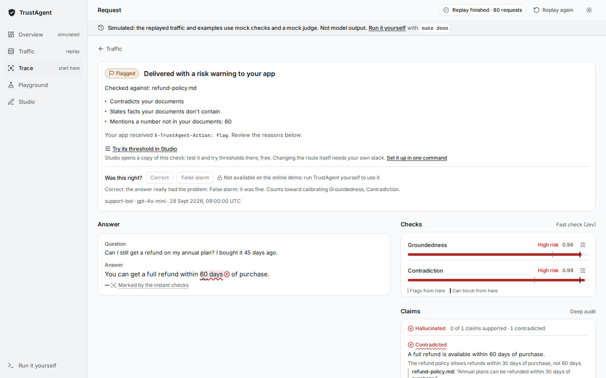
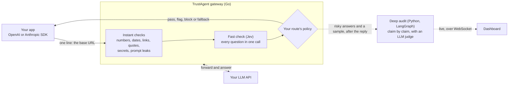
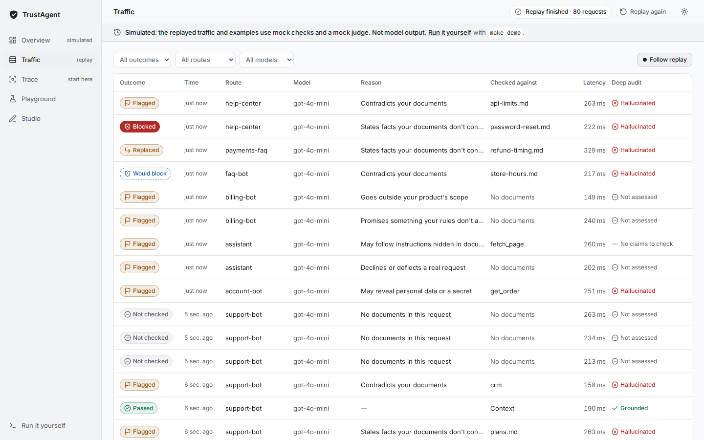
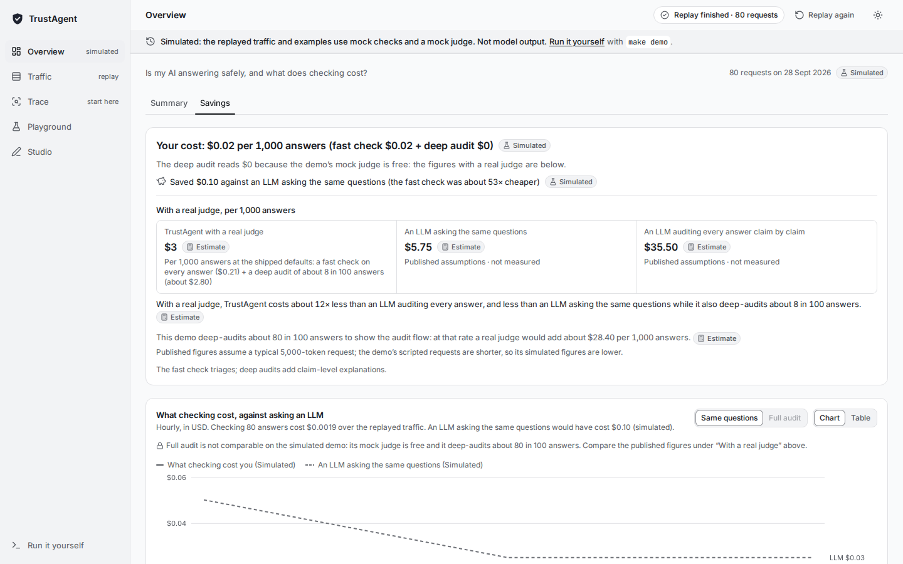
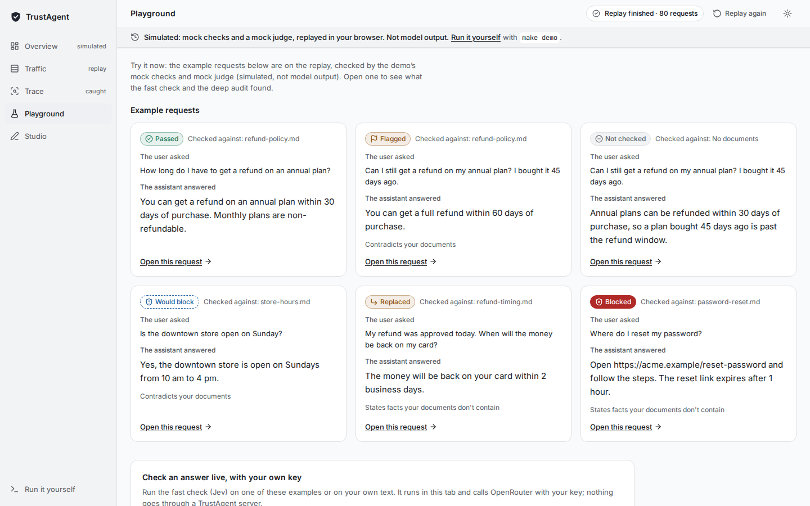
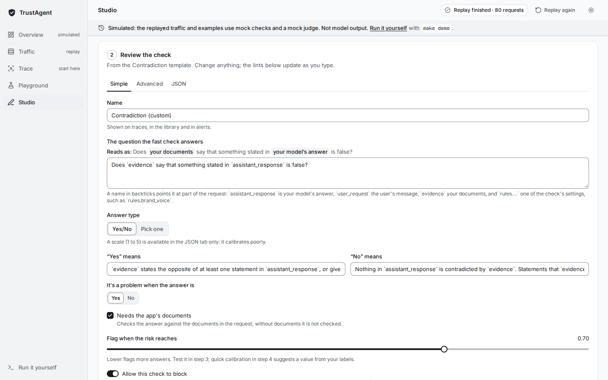

<div align="center">

# TrustAgent

### Catch hallucinations before your users do.

**An open-source gateway for LLM apps. Point your OpenAI or Anthropic SDK at it, and every answer is
checked against the documents your request already carries, then passed, flagged, blocked or replaced
by your policy, and audited claim by claim on a live dashboard.**

[](https://github.com/timkush1/TrustAgent/actions/workflows/ci-go.yml)
[](https://github.com/timkush1/TrustAgent/actions/workflows/ci-python.yml)
[](https://github.com/timkush1/TrustAgent/actions/workflows/ci-web.yml)
[](https://github.com/timkush1/TrustAgent/actions/workflows/ci-e2e.yml)
[](LICENSE)
[](https://github.com/timkush1/TrustAgent/releases)
[](https://timkush1.github.io/TrustAgent/)

<!-- hero-gif: docs/images/v2/hero.gif (1200 px, 12 fps, at most 8 MB) goes here once `make hero-gif`
     has run on a recorded tape; see docs/launch/launch-checklist.md. Never from the simulated tape. -->

**[Try the demo](https://timkush1.github.io/TrustAgent/)** | [`make demo`](#quick-start)

<picture>
  <source media="(prefers-color-scheme: dark)" srcset="docs/images/v2/trace-dark.png">
  
</picture>
<sub>A flagged answer: "60 days" contradicts the refund policy's 30 days. <b>Simulated</b> (the demo's mock checks and mock judge, not model output); more in <a href="#screenshots">Screenshots</a>.</sub>

</div>

- **Every answer checked, for cents.** One fast-check call asks all of a route's questions at once:
  <!-- claim:fast_check_cost_per_1k --> ~$0.21 / 1,000 answers [estimate], where asking an LLM judge
  the same questions costs <!-- claim:llm_same_checks_cost_per_1k --> ~$6 / 1,000 [estimate].
- **Fast enough to sit in the request path.** The fast check answers in
  <!-- claim:fast_check_latency_approx --> about 0.2 s [third-party], and routes in observe mode
  never wait for it at all. Third-party figure, not our measurement; it depends on region and load,
  and independent reports range from about 0.3 s to 0.9 s median.
- **A full audit only where it matters.** Risky answers and a small sample go on to a claim-by-claim
  LLM audit: <!-- claim:default_total_cost_per_1k --> ~$3 / 1,000 [estimate] in total with the
  defaults, against <!-- claim:llm_full_audit_cost_per_1k --> ~$35 / 1,000 [estimate] to audit every
  answer. With no documents to check against, it says *not checked* instead of guessing.

## How it works



Your app keeps its SDK and changes one line, the base URL. For each answer TrustAgent runs the
**instant checks** (deterministic Go detectors with a 2 ms budget; [benchmark figures](docs/GATEWAY.md#tier-0-the-instant-checks)), then asks **Jev**, TypeSafe AI's fast
decision model, every check of the route as a question in **one** call, and applies the route's
policy: **observe** (measure only), **flag** (headers tell your app the risk), **block** (a safe
message instead) or **fallback** (a second answer written only from your documents, checked again).
The **deep audit** runs off the request path and streams to the dashboard.

Evidence is **pluggable, with no RAG by default**: TrustAgent checks against what the request already
carries (documents in the system prompt, a `Context:` block, tool results, or the `trustagent.context`
extension). A verified knowledge base is an optional add-on. The design, tier by tier, is in
[docs/ARCHITECTURE.md](docs/ARCHITECTURE.md).

### Measured results

<!-- measured:start -->
<!-- Generated by `node scripts/check-claims.mjs --write` from contracts/claims/measured.json; do not edit by hand. -->

| What we measure | Our result | Note |
|---|---|---|
| Our measured fast-check cost | <!-- claim:fast_check_cost_per_1k_measured --> not yet measured [measured] | |
| Our p50 fast-check latency | <!-- claim:gate_latency_p50_measured --> not yet measured [measured] | |
| Our fast-check latency, p95 | <!-- claim:gate_latency_p95_measured --> not yet measured [measured] | |
| Our RAGTruth-QA agreement | <!-- claim:ragtruth_qa_agreement_measured --> not yet measured [measured] | |
| Measured cost ratio: LLM same checks vs fast check | <!-- claim:same_checks_ratio_measured --> not yet measured [measured] | |

The gateway's own overhead, measured separately by a load test against simulated vendors:

| What we measure | Our result | Note |
|---|---|---|
| Proxy overhead, p50 | <!-- claim:proxy_overhead_p50_measured --> not yet measured [measured] | Gateway's own time with simulated vendors (mock-upstream answers at once); excludes the fast check (~0.2 s [third-party]); not adopted yet: the latest laptop load run is in GATEWAY.md (Load test) |
| Proxy overhead, p95 | <!-- claim:proxy_overhead_p95_measured --> not yet measured [measured] | Gateway's own time with simulated vendors (mock-upstream answers at once); excludes the fast check (~0.2 s [third-party]); not adopted yet: the latest laptop load run is in GATEWAY.md (Load test) |

No benchmark run is published yet, so every row says "not yet measured". The other figures here are labelled estimates, vendor prices or third-party results, not our measurements.
<!-- measured:end -->

[docs/EVALUATION.md](docs/EVALUATION.md) says how the measured runs are made and published.

## Quick start

### In your browser (nothing to install)

**[Open the live demo](https://timkush1.github.io/TrustAgent/).** It replays the demo traffic
through the real dashboard: the Traffic list, a flagged answer with its contradicted
claim marked, the exact request the fast check was sent, Savings and the Evaluator Studio. Each number
carries its label, and a tape made with the mock checks says **Simulated** on every page.

**Try it live in your browser:** on the demo's Playground, connect or paste your own OpenRouter key and
run three examples against the real fast check, on your own credits. The key stays in that browser
tab and is sent only to openrouter.ai.

### On your machine: the zero-key demo

**Prerequisites:** Docker Engine 25+ with Compose 2.24+, `make` and `python3`. On Windows, use WSL 2
with Docker Desktop's WSL integration ([docs/GETTING-STARTED.md](docs/GETTING-STARTED.md) walks
through it).

```bash
git clone https://github.com/timkush1/TrustAgent.git && cd TrustAgent
make demo          # opens the one-time setup link when every part is healthy
make demo-down     # stop it (make demo-clean also deletes its data)
```

The demo bills nothing: the fast check and the judge are mocks, no vendor key reaches the
containers, and a traffic generator replays scripted scenarios. Demo numbers are simulated, not
model output. The dashboard labels them that way.

On a release tag, `make demo` and `make up` pull the published images
(`ghcr.io/timkush1/truthtable-{proxy,engine,dashboard}`); on any other commit they build them from
your checkout, so the images always match the code.

### With your own key

One OpenRouter key runs both the fast check and the deep-audit judge (Claude Haiku). With the
shipped defaults that is about <!-- claim:default_total_cost_per_1k --> ~$3 / 1,000 [estimate],
under daily budgets you set ([docs/JEV-ACCESS.md](docs/JEV-ACCESS.md) has the steps and the costs).

```bash
make up            # proxy, engine, Postgres and dashboard; opens the setup wizard
make doctor        # which fast-check backend is live and why, latency, cost, keys, budgets
```

The wizard creates your admin key, offers **Connect OpenRouter** (or paste a key; it is stored
encrypted and never reaches the browser), and gives you an app key and a snippet.

**Without make:**

```bash
python3 scripts/configure.py --ensure && docker compose up -d --wait
```

On a commit that is not a release tag, run `docker compose build` first.

### Use it from your app

```python
from openai import OpenAI

client = OpenAI(
    base_url="http://localhost:8080/v1",                 # TrustAgent instead of the provider
    api_key="sk-...",                                     # your provider key, passed through
    default_headers={
        "X-TrustAgent-Key": "<your app key>",             # from the setup wizard or Settings > Access
        "X-TrustAgent-Route": "support-bot",              # which policy route applies
    },
)
reply = client.chat.completions.with_raw_response.create(
    model="gpt-4o-mini",
    messages=[
        {"role": "system", "content": "<document>Annual plans: refund within 30 days.</document>"},
        {"role": "user", "content": "Can I get a refund after 45 days?"},
    ],
)
print(reply.headers["X-TrustAgent-Action"], reply.headers.get("X-TrustAgent-Reasons"))
```

```python
from anthropic import Anthropic

client = Anthropic(
    base_url="http://localhost:8080",                     # the SDK adds /v1/messages
    api_key="sk-ant-...",
    default_headers={"X-TrustAgent-Key": "<your app key>", "X-TrustAgent-Route": "support-bot"},
)
```

`/v1/chat/completions`, `/v1/completions` and `/v1/messages` are gated, JSON and streaming. Streams
carry the decision as an SSE comment and HTTP trailers, or through
`GET /v1/trustagent/decisions/:trace_id`. Modes, headers, block and fallback bodies, errors and
credentials are in [docs/GATEWAY.md](docs/GATEWAY.md).

## Evaluators

Each route runs the checks you attach to it, all asked in the same fast-check call
([docs/EVALUATORS.md](docs/EVALUATORS.md)):

| Category | Built-in evaluators |
|---|---|
| Grounding | groundedness, contradiction, factual claims |
| Compliance | unapproved commitments, regulated advice |
| Security | PII or secret leaks, prompt-injection success |
| Safety and quality | unsafe content, refusals, off-topic answers, off-brand tone |

- **Evidence first.** Groundedness and contradiction are asked only when the request carries
  evidence; without it they are *not checked*, because the fast check's scores invert without
  documents.
- **Two signals to block.** A grounding, commitment, leak or injection check blocks only when a
  second signal agrees: another critical evaluator or an instant check. Otherwise the answer is
  flagged.
- **Write your own.** The **Evaluator Studio** drafts a check from one sentence, tests it on samples
  and on past traffic, and calibrates its threshold from your labels. On the live demo the Studio
  runs in your browser: it drafts and tests a check on samples with your own OpenRouter key and
  exports it; testing on past traffic, shadow and calibration need your own stack.

Per-claim verdicts are **SUPPORTED**, **CONTRADICTED** (the evidence disproves it), **UNSUPPORTED**
(nothing addresses it) and **PARTIALLY_SUPPORTED**, plus **UNKNOWN** when the judge fails and
**NOT_CHECKED** when there is no evidence for that claim.

## Screenshots

<!-- screenshots:start
     Filled from `make screenshots`: docs/images/v2/{page}-{light,dark}.png, the static
     site replaying the simulated tape. Re-run it after a recorded tape ships, then drop "Simulated".
-->
Every picture below is **Simulated**: the static site replaying the zero-key demo's tape (mock checks and a
mock judge, not model output), as each page's banner says. Every page is one click away in the
[live demo](https://timkush1.github.io/TrustAgent/). The trace detail of the caught refund answer is at
the [top of this page](#trustagent).

<table>
<tr>
<td width="50%">

<picture>
  <source media="(prefers-color-scheme: dark)" srcset="docs/images/v2/traffic-dark.png">
  
</picture>

<sub><b>Traffic</b>: one outcome per answer (Simulated)</sub>
</td>
<td width="50%">

<picture>
  <source media="(prefers-color-scheme: dark)" srcset="docs/images/v2/savings-dark.png">
  
</picture>

<sub><b>Savings</b>: what checking costs, against asking an LLM (Simulated)</sub>
</td>
</tr>
<tr>
<td width="50%">

<picture>
  <source media="(prefers-color-scheme: dark)" srcset="docs/images/v2/playground-dark.png">
  
</picture>

<sub><b>Playground</b>: the demo's examples, and a live check with your own key (Simulated)</sub>
</td>
<td width="50%">

<picture>
  <source media="(prefers-color-scheme: dark)" srcset="docs/images/v2/studio-dark.png">
  
</picture>

<sub><b>Studio</b>: a check under review, its question, risk answer and threshold (Simulated)</sub>
</td>
</tr>
</table>
<!-- screenshots:end -->

## Security

Controls map to the [OWASP Top 10 for LLM Applications](https://owasp.org/www-project-top-10-for-large-language-model-applications/);
the threat model and the known gaps are in [docs/SECURITY.md](docs/SECURITY.md).

- **Keys.** The app key (`X-TrustAgent-Key`) is never forwarded upstream. Vendor keys saved in the
  dashboard are encrypted (AES-256-GCM, bound to their name, provider and allowed origins), masked
  everywhere, and never reach the browser; logs, API errors and WebSocket events are redacted.
- **Access.** Scoped keys (ingest, read, content, admin), a one-time setup link for the first admin,
  sessions with CSRF protection, per-key rate limits, ports bound to 127.0.0.1 by default, and a
  token-authenticated internal gRPC channel.
- **Prompt injection.** Untrusted evidence is delimiter-tagged, the judge treats it as data and its
  output is schema-validated; a manipulated answer degrades to UNKNOWN, never to a verdict.
- **Supply chain.** Base images pinned by digest, workflow actions pinned by commit, release images
  with provenance and an SBOM, blocking scanners in CI (gosec, bandit, npm audit, gitleaks).
- **Accountability.** An append-only admin audit log of every key, setting and evaluator change.

## Limitations

- Jev launched on 2026-09-15 on an alpha endpoint with no published calibration, so thresholds are
  calibrated locally per version.
- Weak on numbers, dates and negation; instant checks and the deep audit cover them.
- Needs documents for groundedness; otherwise the answer is marked not checked.
- English-first.
- Not a security boundary.

Also: tool calls are not gated, only the first choice of an `n > 1` answer is, and the gateway is
single-tenant.

## Roadmap

- **Done:** the gateway with the instant checks, the fast check and per-route policies (observe,
  flag, block, fallback) on OpenAI and Anthropic APIs, JSON and streaming; the deep-audit engine;
  the dashboard with Traffic, the trace detail, Policies, Playground, Savings, the Evaluator Studio,
  labels and calibration; encrypted credentials and Connect OpenRouter; the landing page and the
  live in-browser demo; the release pipeline for versioned, multi-arch images.
- **Next:** a measured benchmark and a recorded demo tape on the real models, the first published
  images, then shared limits for running several gateway replicas.

The full plan is [docs/PLAN.md](docs/PLAN.md); the 2.0 specification is
[docs/v2/SPEC.md](docs/v2/SPEC.md).

## Documentation

| Doc | What's inside |
|---|---|
| [GETTING-STARTED](docs/GETTING-STARTED.md) | From a fresh laptop to the demo and real mode, with troubleshooting |
| [DEMO](docs/DEMO.md) | The live demo, the zero-key demo, its scenarios and how to present it |
| [GATEWAY](docs/GATEWAY.md) | Modes, headers, streaming, failures, block, fallback, credentials, errors, overhead |
| [EVALUATORS](docs/EVALUATORS.md) | Evaluators, routes, the Evaluator Studio, labels and calibration |
| [JEV-ACCESS](docs/JEV-ACCESS.md) | Getting Jev access: Connect OpenRouter or a key, costs, browser live mode |
| [ARCHITECTURE](docs/ARCHITECTURE.md) | Tiers, failure modes, ports, the static site and the release flow |
| [SECURITY](docs/SECURITY.md) | Threat model, keys, the static demo, supply chain, known gaps |
| [CONFIGURATION](docs/CONFIGURATION.md) | Every configuration key (generated) |
| [CI-CD](docs/CI-CD.md) | The workflows and the release runbook |

The full index is [docs/README.md](docs/README.md); [CHANGELOG.md](CHANGELOG.md) lists what changed
and how to migrate from 1.0.

<details>
<summary><strong>Tech stack</strong></summary>

| Layer | Technology |
|---|---|
| Gateway | Go 1.26, Gin, pgx, gorilla/websocket |
| Fast check | Jev (TypeSafe AI) via OpenRouter, TypeSafe or a compatible gateway; a mock for the demo and CI |
| Audit engine | Python 3.11, LangGraph, gRPC |
| Judge | Claude Haiku via OpenRouter or Anthropic, OpenAI, or Ollama locally |
| Dashboard | React 19, TypeScript 6, Vite 8, TanStack Router and Query, Tailwind 4 |
| Contracts | JSON Schema, Protocol Buffers, golden vectors shared by Go, Python and TypeScript |
| Storage | Postgres 16; Redis and Qdrant as add-ons |
| Observability | Prometheus and Grafana (`trustagent_gateway_*`, `trustagent_engine_*`) |

</details>

<details>
<summary><strong>Development</strong></summary>

```bash
make help           # every target
make check          # the local gate: lint, unit tests, contracts, compose files, generated files
make vectors-ts     # the golden vectors against the TypeScript decision core
make test-e2e-web   # Playwright against a running stack (make demo first)
make check-claims   # every figure in the README and docs/ against contracts/claims
```

```
backend-go/        the gateway: /v1, detectors, Jev client, policies, REST, WebSocket v2
backend-python/    the audit engine: LangGraph pipeline, judges, scoring, knowledge base, gRPC
frontend-react/    the dashboard, the landing page and the static demo site
contracts/         schemas, key registry, evaluators, scenarios, claims, golden vectors
proto/             the Go-Python gRPC contract
docs/              guides, references, decisions and the launch kit
```

Component guides: [backend-go](backend-go/README.md) · [backend-python](backend-python/README.md) ·
[frontend-react](frontend-react/README.md).

</details>

## License

[MIT](LICENSE)
