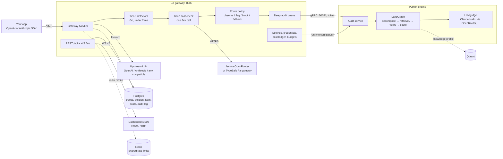

# Architecture

How TrustAgent is put together, what each tier does, what happens when a part fails, and which
ports it uses. The full design is [v2/SPEC.md](v2/SPEC.md); the gateway's client-facing behaviour
is in [GATEWAY.md](GATEWAY.md).

## System overview

## The tiers

Every answer that passes through the gateway is checked in tiers, cheapest first.

| Tier | What | Where | Cost and time |
|---|---|---|---|
| **Tier-0 detectors** | Deterministic checks of the answer against the evidence the request carries: numbers, dates, URLs, quotes and citations not in the evidence, secret patterns, system-prompt leaks | Go, in process | $0, under 2 ms |
| **Tier-1 fast check** | Every evaluator of the route asked as a question in **one** Jev call, behind a vendor-neutral `DecisionModel` (OpenRouter, TypeSafe, a compatible gateway, mock, off) | Go → vendor over HTTPS | about $0.0002 per answer, about 0.2 s **[estimate]** |
| **Policy** | The route's mode turns detector findings and evaluator levels into an action: observe, pass, flag (headers), block, or fallback (a second upstream, re-checked) | Go | — |
| **Tier-2 deep audit** | Claim-by-claim verification by an LLM judge, asynchronous, for flagged answers plus small pass and uniform samples | Python engine | about $0.035 per audited answer **[estimate]** |

Groundedness is only asked when the request carries evidence (documents in the system prompt,
user-message context, tool results, the `trustagent.context` extension). Without evidence it is
`not_assessed`: Jev's scores invert without evidence, so it is never asked. The knowledge base
(Qdrant) is an optional profile, not the default.

The client gets its answer as soon as the policy has decided; on observe routes it gets it at once
and the check runs alongside. The deep audit never delays an answer.

## The control plane

What an operator changes at run time lives in Postgres and applies without a restart:

- **Policies:** versioned YAML or dashboard edits, hot-reloaded, with rollback.
- **Settings:** the decision model, the judge, upstreams, bindings, budgets and price overrides.
  Each change bumps one runtime-config version; the gateway pushes `(epoch, version)` to the
  engine, and `make doctor` checks that the engine runs the version the gateway holds.
- **Credentials:** vendor keys entered in the dashboard (Connect OpenRouter or paste), encrypted
  with AES-256-GCM, bound to the origins they may be sent to, never returned to the browser
  ([SECURITY.md](SECURITY.md)). A key in `.env` always wins.
- **Cost ledger and budgets:** every decision call and judge call is recorded with its cost; the
  daily budgets read it, and the Savings page shows it next to labelled estimates.
- **Evaluators and calibrations:** versions saved by the Evaluator Studio, labels, and calibrations
  fitted from them ([EVALUATORS.md](EVALUATORS.md)).
- **Admin audit log:** every security-relevant change, append-only.

## Failure modes

| Fails | What happens | Where it shows |
|---|---|---|
| Jev (timeout, 5xx, 429, breaker open, no key, budget spent) | `fail: open` routes (the default) pass the answer with what was assessed; `fail: closed` block and fallback routes block. Retries, hedging and a circuit breaker recover by themselves. | `X-TrustAgent-Status` / `-Degraded`, `/api/status`, banner, `make doctor` |
| The upstream LLM | Its own error reaches the client (502/504 when it cannot be reached); nothing is enforced | `skipped:upstream_error` |
| The engine | Answers are still gated by Tier-0 and Tier-1; deep audits are dropped and reported | `audit_dropped`, `/health` `audit_engine`, `make doctor` |
| The judge's budget | Deep audits pause until tomorrow (UTC); fast checks continue | Banner, `audit_dropped{llm_budget}` |
| Postgres | The gateway keeps gating with the policy it has loaded; traces are not stored and dashboard changes cannot be saved | `/api/status` persistence, `make doctor` |
| The master key | Saved keys are listed as undecryptable and never used; keys in `.env` keep working | `master_key_changed` warning, `make doctor` |
| Qdrant (knowledge) | No knowledge evidence for that answer, never a failure | trace evidence sources |
| Redis | Rate limits fall back to each process's memory | `/api/status` redis |

## Ports

Every published port binds `BIND_ADDR` (127.0.0.1 by default).

| Port | Service | Published |
|---|---|---|
| 8080 (`PROXY_HOST_PORT`) | Gateway: `/v1`, `/api`, `/ws`, `/health` | yes |
| 3000 (`DASHBOARD_HOST_PORT`) | Dashboard (nginx; proxies `/v1`, `/api`, `/ws` to the gateway) | yes |
| 5432 (`POSTGRES_HOST_PORT`) | Postgres | yes (not in the demo) |
| 50051 | Engine gRPC (token-authenticated, plaintext) | no |
| 8002 / 8001 | Gateway / engine Prometheus metrics | no |
| 6333, 6334 | Qdrant (`knowledge` profile) | yes |
| 11434 | Ollama (`local-llm` profile) | yes |
| 9090, 3001 | Prometheus, Grafana (`observability` profile) | yes |
| 6379 | Redis (`redis` profile) | yes |
| 8090 (`MOCK_UPSTREAM_HOST_PORT`, 18090) | mock-upstream (e2e, load; on the host only in the onboarding stack) | onboarding only |

## Design decisions and trade-offs

The ADRs live in [DECISIONS.md](DECISIONS.md); the headlines:

- **Go gateway + Python engine.** The hot path (HTTP interception, streaming, the decision call)
  wants Go's concurrency and small static binaries; the audit path (LangGraph, LLM providers)
  wants Python's ecosystem. A committed gRPC contract keeps the seam honest.
- **A cheap classifier in the request path, an LLM judge off it.** One Jev call answers every
  check of a route for about $0.21 per 1,000 answers **[estimate]**, fast enough to block; the
  expensive claim-level audit runs asynchronously on the answers that need an explanation, plus a
  uniform sample that keeps the headline hallucination rate unbiased.
- **Block only when calibrated and corroborated.** A block needs a calibration of the current Jev
  snapshot and, for groundedness, a second agreeing signal. Otherwise the route is capped at flag
  and says why.
- **Contracts first.** JSON Schemas, templates, prices and golden vectors live in `contracts/`;
  Go is the reference implementation and the TypeScript decision core conforms to the same vectors.
- **Honest numbers.** Every figure carries a label (measured, estimate, vendor, third-party,
  simulated), and mock output is never shown as measured.

## Repository layout

| Path | What |
|---|---|
| `backend-go/cmd/proxy` | Entry point, route wiring, REST handlers |
| `backend-go/internal/{gate,decision,jev,evidence,policy}` | Tier-0, the decision core, the Jev client, evidence extraction, policies |
| `backend-go/internal/{credentials,runtimecfg,costs,authz}` | Encrypted keys, runtime settings, the cost ledger, access control |
| `backend-go/internal/{proxy,llmapi,upstream,worker,websocket,store}` | Gateway handler, API formats, upstreams, the audit queue, WS v2, Postgres |
| `backend-python/src/truthtable/graphs` | The LangGraph audit pipeline |
| `backend-python/src/truthtable/{providers,scoring,runtime,studio,kb}` | Judge providers, scoring, pushed runtime config, the Studio drafter, the optional knowledge base |
| `frontend-react/src` | The dashboard and the static site |
| `contracts/` | Cross-language source of truth: schemas, templates, prices, vectors |
| `proto/evaluator.proto` | The Go ↔ Python contract |

## Testing strategy

| Layer | What guards it |
|---|---|
| Decision logic | Golden vectors (decide, lint, cost, detectors) run by Go, the reference, and by TypeScript and Python where they apply |
| Gateway paths | In-process end-to-end tests against mock-upstream, plus the compose e2e stack in CI |
| Pipeline | Golden-set regression gate over recorded model output (blocking in CI) |
| Secrets | Leak tests feeding fake keys (and one no pattern matches) through logs, API, WS and gRPC; gitleaks over the history |
| Dashboard | Vitest units, Playwright on the demo, e2e and onboarding stacks, and on the static site |
| Security posture | Blocking gosec, bandit, npm audit and gitleaks; Trivy informational |
