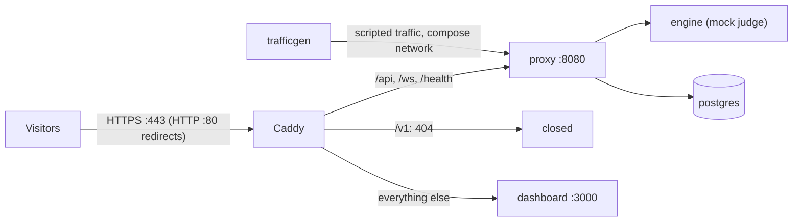

# Deploy the public demo on a small VM

This guide puts the zero-key demo (`make demo`) on a small cloud server, so anyone can open the
live dashboard at an HTTPS address at any time. It takes about 30 minutes the first time.

**What visitors get.** The full dashboard (Overview, Traffic, trace details, Studio, Savings)
with scripted traffic arriving every minute. The fast check and the deep-audit judge are the mock
backends of the demo, so no vendor is ever called, no key exists on the server, and every surface
says **Simulated**. The dashboard is **read-only**: visitors can look at everything and change
nothing.

**Do you need it?** Often not:

| Option | Cost | Best for |
|---|---|---|
| The [GitHub Pages site](DEMO.md#the-live-demo-in-your-browser) | $0 | A link in a post or a CV. Always on, no server: it replays a recorded tape and runs real checks with the visitor's own key |
| `make demo` plus a Cloudflare quick tunnel ([DEMO.md §5](DEMO.md#5-share-it)) | $0 | One interviewer for one hour, from your laptop |
| This guide: a VM running the demo stack behind Caddy | from €5.99 a month excl. VAT [vendor] (Hetzner CX23; see [Cost](#cost)) | A live dashboard that is always there, for any number of visitors |

## Contents

- [How it works](#how-it-works)
- [Cost](#cost)
- [Before you start](#before-you-start)
- [Step 1: create the server](#step-1-create-the-server)
- [Step 2: prepare the server](#step-2-prepare-the-server)
- [Step 3: get TrustAgent at the release tag](#step-3-get-trustagent-at-the-release-tag)
- [Step 4: choose the address](#step-4-choose-the-address)
- [Step 5: start it](#step-5-start-it)
- [Step 6: check it from outside and claim the admin](#step-6-check-it-from-outside-and-claim-the-admin)
- [Run it](#run-it): logs, upgrades, stopping, deleting
- [A local rehearsal](#a-local-rehearsal)
- [Troubleshooting](#troubleshooting)
- [Why not Oracle Cloud's Always Free tier](#why-not-oracle-clouds-always-free-tier)

## How it works



`make public-demo-up` starts the demo stack (`docker-compose.yml` + `docker-compose.demo.yml`)
with one more file, `docker-compose.public.yml`, as compose project `truthtable-demo`:

- **Caddy is the only door.** It is the only service with host ports: 80 and 443 (TCP, and UDP
  443 for HTTP/3). It gets a free Let's Encrypt certificate for your address and renews it. The
  proxy, the dashboard and the database publish nothing.
- **Caddy talks to the proxy directly** for `/api`, `/ws` and `/health`. The dashboard's nginx
  would replace each visitor's address with its own, and the proxy's per-address limits (10 live
  connections and 120 requests a minute by default) would then be shared by everyone. Caddy
  writes the real address into `X-Forwarded-For`, which the proxy trusts only from the compose
  network (`TRUTHTABLE_TRUSTED_PROXIES`, `172.16.0.0/12` by default).
- **The gateway API is closed.** `/v1` answers 404 at the edge. The demo runs in test mode, so an
  open `/v1` would let anyone script answers into the shared dashboard.
- **Read-only, short memory.** `TRUTHTABLE_READONLY=true` refuses every write in the dashboard,
  and traces are kept for 7 days (`TRUTHTABLE_RETENTION_DAYS=7`). Every container's log is rotated
  (3 files of 10 MB), so the disk does not fill up over months.
- **Pulled, never built.** The server pulls the release images of the version you checked out;
  it never compiles anything (`up --no-build`).
- **Sized for 4 GB.** The engine is capped at 1 GB here (4 GB in the default stack), Caddy at
  128 MB. The whole demo stack stays well under 1 GB [estimate] while it runs
  ([GETTING-STARTED.md](GETTING-STARTED.md#6-how-much-memory-it-needs)); check yours with
  `docker stats --no-stream`.

The files: [`docker-compose.public.yml`](../docker-compose.public.yml),
[`deploy/public-demo/Caddyfile`](../deploy/public-demo/Caddyfile) and
[`scripts/public_demo.py`](../scripts/public_demo.py), which checks the address before the start
and the running stack after it.

## Cost

| Item | Price | Label |
|---|---|---|
| Hetzner Cloud CX23: 2 vCPU (x86), 4 GB RAM, 40 GB disk, 20 TB traffic in EU locations | from €5.99 a month excl. VAT, or €0.0096 an hour up to that cap | [vendor] Hetzner's price page, read 2026-10-21; re-check before you create the server |
| The same, for a year | about €72 excl. VAT | [estimate] 12 × the monthly price |
| The address | $0 with `<your-ip-with-dashes>.sslip.io`, or the domain you already own | |
| Certificates (Let's Encrypt) | $0 | |
| Vendor calls (Jev, the judge) | $0: the demo calls no vendor | |

- **IPv4.** The demo needs a public IPv4 address. Hetzner's price page has a "Price incl. IPv4"
  switch: read the price with it on.
- **Billing stops when the server is deleted**, not when it is switched off.
- **Why Hetzner.** A small, steady x86 VM with a public IPv4 address, priced per hour with a
  monthly cap. Any provider with 2 vCPU, 4 GB, Ubuntu and a firewall works the same way.

## Before you start

- The release you deploy is published: its images are on GHCR and public, so
  `docker pull ghcr.io/timkush1/truthtable-proxy:<version>` works without signing in.
- A Hetzner Cloud account ([console.hetzner.cloud](https://console.hetzner.cloud)).
- An SSH key on your computer. If you have none: `ssh-keygen -t ed25519` (press Enter for the
  default file, then choose a passphrase). The public half is `~/.ssh/id_ed25519.pub`.

## Step 1: create the server

In the Hetzner Cloud console, create a project, then **Add Server**:

1. **Location:** any EU location (Nuremberg, Falkenstein or Helsinki).
2. **Image:** Ubuntu 24.04 (or a newer LTS).
3. **Type:** shared vCPU, x86, **CX23** (2 vCPU, 4 GB).
4. **Networking:** public IPv4 and IPv6 on.
5. **SSH key:** paste your `~/.ssh/id_ed25519.pub`.
6. **Firewall:** create one with these inbound rules, and attach it:

   | Protocol | Port | Source | Why |
   |---|---|---|---|
   | TCP | 22 | your own IP address only | SSH for you |
   | TCP | 80 | any | Let's Encrypt and the redirect to HTTPS |
   | TCP | 443 | any | the demo |
   | UDP | 443 | any | HTTP/3 (optional) |

7. **Name:** for example `trustagent-demo`. Create it and note its **IPv4 address**.

Use the provider's firewall, not `ufw` on the server: Docker publishes its ports past `ufw`.

## Step 2: prepare the server

Connect (replace the address with yours):

```bash
ssh root@203.0.113.10
```

Update the system, install the tools and Docker (Engine 25 or later, Compose 2.24 or later; the
official script installs the current versions, see
[docs.docker.com](https://docs.docker.com/engine/install/ubuntu/) for the apt-repository way):

```bash
apt-get update && apt-get -y upgrade
apt-get install -y git make python3 curl
curl -fsSL https://get.docker.com | sh
docker --version && docker compose version
```

Add a 2 GB swap file, a cushion for the first image pulls and for memory peaks:

```bash
fallocate -l 2G /swapfile && chmod 600 /swapfile && mkswap /swapfile && swapon /swapfile
echo '/swapfile none swap sw 0 0' >> /etc/fstab
free -h    # Swap: 2.0Gi
```

Docker starts at boot by itself, and every demo container restarts with it.

## Step 3: get TrustAgent at the release tag

Check out the exact release you want to show (here `v2.0.0`). The version in its `VERSION` file
picks the images, so the server runs exactly that release:

```bash
git clone --depth 1 --branch v2.0.0 https://github.com/timkush1/TrustAgent.git
cd TrustAgent
python3 scripts/configure.py --ensure    # creates .env with generated passwords (mode 0600)
```

## Step 4: choose the address

**No domain? Use sslip.io (free).** `203-0-113-10.sslip.io` resolves to `203.0.113.10` for
everyone, so it needs no DNS setup. One command writes it to `.env` (use your server's IPv4):

```bash
python3 scripts/public_demo.py set-url --sslip 203.0.113.10
# TRUTHTABLE_PUBLIC_URL=https://203-0-113-10.sslip.io written to .env
```

**Your own domain?** Create a DNS **A** record (for example `demo.example.org`) pointing at the
server's IPv4 address, wait until `getent hosts demo.example.org` on the server prints that
address, then:

```bash
python3 scripts/public_demo.py set-url https://demo.example.org
```

Add no **AAAA** (IPv6) record: Docker hands IPv6 connections to its containers through a helper
that hides the visitor's address, so every IPv6 visitor would share one set of limits.

The address must be a bare `https://<name>`: no IP address, port, path or trailing slash. The
check explains what is wrong if it is not.

## Step 5: start it

```bash
make public-demo-up
```

It runs, in order:

1. `configure.py --ensure` (nothing changes if `.env` is complete);
2. `public_demo.py url`: stops right here, with the fix, if `TRUTHTABLE_PUBLIC_URL` cannot work;
3. `docker compose … pull`: the release images, Postgres and Caddy (a few minutes the first time);
4. `docker compose … up -d --no-build --wait`: starts everything and waits until each service
   is healthy;
5. `public_demo.py verify`: checks the running stack through Caddy, from the server itself.

A good run ends like this:

```text
PASS  edge.caddy_trusted   the proxy trusts Caddy (172.18.0.7 in 172.16.0.0/12)
PASS  edge.setup_status    the proxy answers through the edge: demo, read-only; no admin yet (make public-demo-setup-url mints the one-time link)
PASS  edge.gateway_closed  /v1 answers 404 at the edge
PASS  edge.dashboard       the dashboard answers through the edge
PASS  edge.http_redirect   port 80 redirects to https (Let's Encrypt renewals use it)
public demo: https://203-0-113-10.sslip.io (DEMO MODE: simulated checks, read-only, no keys). …
```

The HTTP checks retry for up to 3 minutes while Caddy gets its certificate (usually a few
seconds). `make public-demo-check` runs them again at any time.

## Step 6: check it from outside and claim the admin

1. **Open the address from another network**, for example your phone on mobile data. This also
   proves the firewall, which the server cannot see from inside. The top bar shows **Demo**,
   **Read-only** and **Simulated checks**, and new traces arrive every minute.
2. **Claim the admin right away:**

   ```bash
   make public-demo-setup-url
   ```

   It prints `SETUP: open https://<your address>/app/setup#token=…`. Open that link in your own
   browser: it creates the admin key, shows it once, and signs you in. Keep the key in your
   password manager. The link works once and expires; each run of the command replaces the
   previous one. In read-only mode the admin can see every setting but change none.

## Run it

| Task | Command |
|---|---|
| Follow the logs | `make public-demo-logs` (one service: `SERVICE=caddy`) |
| Check the edge again | `make public-demo-check` |
| See memory and CPU | `docker stats --no-stream` |
| Stop it (keeps the data and the certificate) | `make public-demo-down` |
| Start it again | `make public-demo-up` |
| Upgrade to a new release | `git fetch --depth 1 origin tag v2.0.1 && git checkout v2.0.1 && make public-demo-up` |
| Delete it | `make public-demo-clean`, then delete the server in the console |

- **On this server, use only the `public-demo-*` targets.** They share the demo's project name,
  so `make demo` would replace the public containers with the laptop version (ports 3000 and
  8080 on 127.0.0.1, no Caddy). `make public-demo-up` puts them back.
- **Updates.** Ubuntu installs security updates by itself (`unattended-upgrades`). Reboot now and
  then (`reboot`); the demo comes back on its own.
- **Backups:** none needed. The database holds only scripted, simulated traffic of the last 7
  days. `make public-demo-clean` also deletes the certificate, and Let's Encrypt limits how many
  new certificates one name gets per week, so do not clean the stack for a routine restart.
- **The Caddy image** is pinned by digest in `docker-compose.public.yml` (the date of the pin is
  next to it). To move it on: `docker buildx imagetools inspect caddy:2-alpine` prints the current
  index digest; put it in the file and run `make public-demo-up`.

## A local rehearsal

Maintainers can try the whole public stack on a laptop, without a certificate or open ports.
`TRUTHTABLE_PUBLIC_URL=http://localhost:28443` adds
[`deploy/public-demo/local.yml`](../deploy/public-demo/local.yml): Caddy serves plain HTTP on
`127.0.0.1:28443` only, and images that already exist locally are not pulled again. Build the
images first (`make demo` builds them for this checkout's version, then `make demo-down`), and use
a project of its own:

```bash
TRUTHTABLE_PUBLIC_URL=http://localhost:28443 make public-demo-up PUBLIC_DEMO_PROJECT=truthtable-pubtest
# open http://localhost:28443
make public-demo-clean PUBLIC_DEMO_PROJECT=truthtable-pubtest
```

On a laptop every request reaches Caddy from Docker's own gateway address, so all local requests
count as one visitor; on the server each visitor keeps their own address.

## Troubleshooting

| Symptom | Cause and fix |
|---|---|
| `public demo: TRUTHTABLE_PUBLIC_URL is not set` (or another reason) | Step 4. A value in your shell wins over `.env`: `unset TRUTHTABLE_PUBLIC_URL`. |
| `docker compose … pull` asks to sign in, or says "not found" | The release images are not public on GHCR yet, or the checkout is not a release tag (`cat VERSION`). |
| `FAIL edge.http_redirect`, or the browser says the certificate is invalid | Port 80 or 443 is closed (the firewall of Step 1), or the address does not resolve to this server (`getent hosts <name>`). `make public-demo-logs SERVICE=caddy` shows Let's Encrypt's answer. |
| Caddy's log mentions a rate limit | sslip.io is shared by everyone, and so are Let's Encrypt's limits for it. Wait an hour and run `make public-demo-up` again, or use your own domain. |
| `FAIL edge.caddy_trusted` | Docker gave the compose network addresses outside `172.16.0.0/12`. Set `TRUTHTABLE_TRUSTED_PROXIES` in `.env` to that network's subnet (`docker network inspect truthtable-demo_default`, the `Subnet` line), then `make public-demo-up`. |
| `FAIL edge.setup_status: read-only is off` | The stack was started without `docker-compose.public.yml` (for example by `make demo`). Run `make public-demo-up`. |
| A service restarts again and again | `make public-demo-logs SERVICE=<name>`; `docker stats --no-stream` and `free -h` show whether memory runs out. |

## Why not Oracle Cloud's Always Free tier

Oracle's free Ampere A1 allowance is generous on paper, 2 OCPUs and 12 GB of memory (1,500 OCPU
hours and 9,000 GB hours a month) [vendor], but it does not suit an always-on demo:

- **Idle servers are reclaimed.** Oracle may reclaim an Always Free instance that is idle for 7
  days: CPU use at the 95th percentile, network use and (for A1) memory use all under 20%
  [vendor]. A demo that waits for visitors is idle most of the time.
- **A1 capacity is often unavailable** in busy regions when you try to create the instance.
- **Two firewalls.** Besides the security list, Oracle's Ubuntu images ship host firewall
  (iptables) rules that allow only SSH, so ports 80 and 443 have to be opened on the server too.

Figures from Oracle's "Always Free Resources" page, read 2026-10-21.
