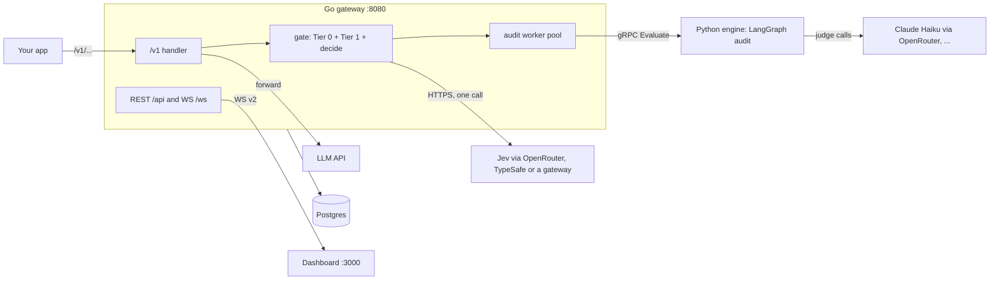
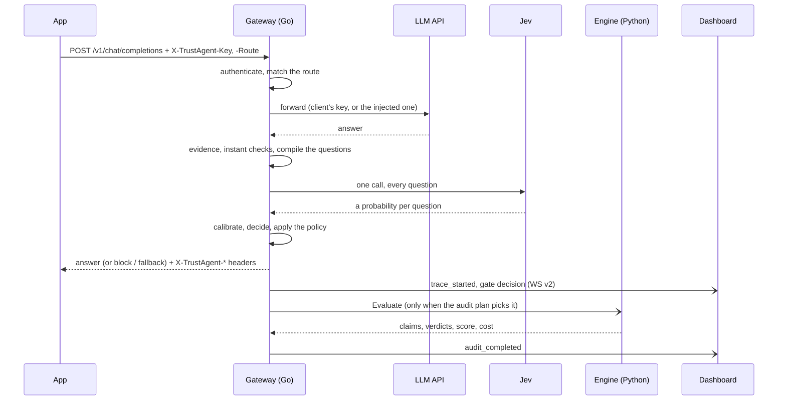

# TrustAgent: the walkthrough

*A guided tour of the whole project for an engineer who wants to understand it end to end: what
the product decides and why, the life of one request, each service, the browser demo, the
contracts that keep three languages in step, the DevOps, the security model, the tests and the
release pipeline. It assumes you can code but may be new to some of the infrastructure ideas
(gRPC, WebSockets, Prometheus, GitHub Actions, CSP); each one is explained where it first
appears.*

This tour explains *how the parts fit*. For exact behaviour, the references win:
[GATEWAY.md](GATEWAY.md) (the client-facing contract), [EVALUATORS.md](EVALUATORS.md),
[SECURITY.md](SECURITY.md), [ARCHITECTURE.md](ARCHITECTURE.md) and the 2.0 specification,
[v2/SPEC.md](v2/SPEC.md).

**Reading time: about 2 hours**, in three sittings:

| Sitting | Sections | You will understand |
|---|---|---|
| 1 | 1–4 | What the product does, and the full life of a request |
| 2 | 5–9 | Each service, the contracts, the dashboard and the browser demo |
| 3 | 10–17 | Docker and releases, observability, security, tests, CI, a runbook and the lessons |

## Table of contents

1. [What the product is](#1-what-the-product-is)
2. [The big picture](#2-the-big-picture)
3. [Ports: who listens where](#3-ports-who-listens-where)
4. [Life of a request, end to end](#4-life-of-a-request-end-to-end)
5. [The Go gateway, piece by piece](#5-the-go-gateway-piece-by-piece)
6. [The Python audit engine, piece by piece](#6-the-python-audit-engine-piece-by-piece)
7. [Contracts: one truth for three languages](#7-contracts-one-truth-for-three-languages)
8. [The dashboard](#8-the-dashboard)
9. [The static site and the live browser demo](#9-the-static-site-and-the-live-browser-demo)
10. [Docker, Compose, make and releases](#10-docker-compose-make-and-releases)
11. [Observability](#11-observability)
12. [Security: what protects what](#12-security-what-protects-what)
13. [Testing: what proves it works](#13-testing-what-proves-it-works)
14. [CI/CD on GitHub Actions](#14-cicd-on-github-actions)
15. [Runbook](#15-runbook)
16. [Lessons learned](#16-lessons-learned)
17. [Glossary](#17-glossary)

---

## 1. What the product is

LLMs state falsehoods with total confidence: a support bot promises a 60-day refund window when
the policy it was given says 30. **TrustAgent** sits between an app and its model and checks every
answer before the user acts on it.

The app keeps its SDK and changes one line, the base URL. TrustAgent then:

1. **forwards** the request to the real LLM API (OpenAI, Anthropic or any compatible one);
2. **checks** the answer in tiers, cheapest first:
   - the **instant checks** (Tier 0): deterministic Go detectors for numbers, dates, links, quotes
     and citations that are not in the evidence, secret patterns and system-prompt leaks, with a
     budget of under 2 ms for up to 32k tokens of documents
     ([benchmark figures](GATEWAY.md#tier-0-the-instant-checks));
   - the **fast check** (Tier 1): every check of the route, asked as a question to **Jev**,
     TypeSafe AI's decision model, in **one** call;
3. **applies the route's policy**: observe (measure only), flag (headers tell the app), block (a
   safe message instead) or fallback (a second answer written only from the documents, checked
   again);
4. sends risky answers, and a small sample of the rest, to the **deep audit** (Tier 2), a
   claim-by-claim LLM audit that runs off the request path and streams to the dashboard.

Two principles shape everything below:

- **Evidence is pluggable, with no RAG by default.** Groundedness is checked only against what the
  request already carries: documents in the system prompt, a `Context:` block in the user message,
  tool results, or the `trustagent.context` body extension. With no evidence the result is
  **not assessed**, and Jev is never asked a groundedness question, because its scores invert
  without evidence. A retrieval-backed knowledge base exists, but as an optional add-on.
- **Honest numbers.** Every figure the product shows carries a label (measured, estimate,
  third-party, vendor or simulated). Mock output is never presented as measured, and a claim's
  CONTRADICTED (the evidence disproves it) stays distinct from UNSUPPORTED (nothing addresses it)
  from the judge to the pixel.

Why tiers? Cost and time. A full LLM audit of every answer costs about
<!-- claim:llm_full_audit_cost_per_1k --> ~$35 / 1,000 [estimate]; the fast check costs about
<!-- claim:fast_check_cost_per_1k --> ~$0.21 / 1,000 answers [estimate] and is quick enough to
block on, so the expensive tier runs only where an explanation is worth paying for.

---

## 2. The big picture



| Service | Language | Job |
|---|---|---|
| **proxy** (the gateway) | Go 1.26, gin | The `/v1` LLM APIs, Tier 0 and Tier 1, policies, the REST API, the WebSocket stream, the audit queue, credentials, costs and budgets |
| **engine** | Python 3.11, LangGraph, gRPC | The deep audit: decompose an answer into claims, verify each against the evidence with an LLM judge, score it; the Studio's AI drafter; the optional knowledge base |
| **postgres** | Postgres 16 | Traces, gate decisions, audits, policy versions, keys, encrypted credentials, the cost ledger, the admin audit log |
| **dashboard** | React 19, served by nginx | Overview, Traffic, trace detail, Policies, Playground, Evaluators and the Studio, Savings, Settings |

Add-ons are Compose profiles: `knowledge` (Qdrant plus the knowledge base), `local-llm` (Ollama
as the judge), `observability` (Prometheus and Grafana) and `redis` (rate limits shared between
gateway replicas).

There is also a **static site**: the same dashboard built without a backend, published on GitHub
Pages next to a landing page. It replays a recorded tape of demo traffic and lets a visitor run
real checks from the browser with their own OpenRouter key ([§9](#9-the-static-site-and-the-live-browser-demo)).

---

## 3. Ports: who listens where

Every published port binds `BIND_ADDR`, which is `127.0.0.1` by default: nothing on your network
can reach the stack unless you change it.

| Port | What | Published |
|---|---|---|
| 8080 | Gateway: `/v1`, `/api`, `/ws`, `/health` | yes (`PROXY_HOST_PORT`) |
| 3000 | Dashboard (nginx; proxies `/v1`, `/api`, `/ws` to the gateway) | yes (`DASHBOARD_HOST_PORT`) |
| 5432 | Postgres | yes, except in the demo |
| 50051 | Engine gRPC (plaintext, token-authenticated) | no |
| 8002 / 8001 | Gateway / engine Prometheus metrics | no |

The add-on ports (Qdrant, Ollama, Prometheus, Grafana, Redis) are in
[ARCHITECTURE.md](ARCHITECTURE.md#ports). Why does the dashboard proxy the API? So the browser
talks to one origin: no CORS configuration, and session cookies stay first-party.

---

## 4. Life of a request, end to end



### Step 0: what the client sends

An ordinary OpenAI or Anthropic request, plus two headers:

- `X-TrustAgent-Key`: the **app key** (scope `ingest`) that says who is calling. It is never
  forwarded upstream.
- `X-TrustAgent-Route`: which policy route applies (optional; routes can also match on paths,
  models or the key's label).

The documents the answer must stick to travel inside the request, for example a
`<document>` block in the system prompt. That is the evidence.

### Step 1: authenticate and pick the route

`internal/authz` checks the key and its scope. `internal/policy` holds the policy in effect
(`config/policies.yaml` as the seed, then versions edited on the dashboard and stored in Postgres)
and picks the first route whose `match` fits. The route says the **mode** (observe, flag, block,
fallback), the evaluators attached to it, its deadline (600 ms by default) and what to do when
the check fails (`fail: open` or `closed`).

### Step 2: forward to the LLM

`internal/proxy` hands the body to `internal/upstream`, which forwards it to the LLM API of the
request's family. `internal/llmapi` knows the three wire formats the gateway reads and writes:
`openai_chat`, `openai_completions` and `anthropic_messages`, JSON and server-sent events (SSE).
In **passthrough** mode the client's own `Authorization` header goes upstream; in **inject** mode
the gateway strips every client credential and adds its own key.

**Observe routes never wait:** the answer goes back byte-identical at once, and the check runs
alongside it. Every other mode decides first.

### Step 3: evidence and the instant checks

`internal/evidence` extracts what the answer will be checked against from the request itself
(SPEC §7.1). Then `internal/gate` runs the Tier-0 detectors (`internal/decision/detectors.go`):
numbers, dates, URLs, quotes and citations in the answer that the evidence does not contain, secret
patterns and leaks of the system prompt. They are deterministic and cost nothing. Numbers and dates
never flag alone; they are a second signal.

### Step 4: the fast check

The gate **compiles** the route's evaluators into one question set (`decision.Compile`): each
evaluator is a question with its instructions; the state holds the answer and, where an evaluator
needs it, the evidence. An evaluator that requires evidence is left out, as `not_assessed`, when
there is none. The compiled request is canonical JSON (RFC 8785), so its SHA-256 fingerprint is
stable and the dashboard can later prove that the request it shows is the one that was sent.

`internal/jev` sends that request in **one** call. The backend sits behind a vendor-neutral
interface: OpenRouter's decisions endpoint (the default with an OpenRouter key), TypeSafe directly,
any compatible gateway, a mock (the demo) or off. The client is built for a request path: retries
that honour `Retry-After`, **hedging** (a second request when the first is slow, the first answer
wins), a circuit breaker that counts only vendor faults, a rate limiter with a reserve for
synchronous routes, and a **spend reservation** against the daily budget before every attempt.

### Step 5: calibrate and decide

Jev answers with a probability per question. A raw probability is not a decision: its meaning
shifts between model snapshots. So the gate looks up the **calibration** for the snapshot that
answered (Platt or isotonic fits from labels, `internal/calibration`) and calls `decide()`
(`internal/decision/decide.go`), which turns calibrated scores and detector findings into a level
per evaluator (pass, warn, critical) and an **action**:

- **block** only when the route enforces, the evaluator may block, its threshold is calibrated
  for this snapshot, and a **second signal** it names agrees (another critical evaluator or a
  detector; an evaluator that names none, such as unsafe content, needs no second signal).
  Otherwise the action is capped at flag with the reason `needs_second_signal`;
- **flag** when a warn or critical level is reached;
- **pass** otherwise.

What happens when Jev times out, errors or the budget is spent is the route's `fail` setting;
it is never silent: the status and the degradation reach the headers and the dashboard.

### Step 6: answer the client

The response carries `X-TrustAgent-*` headers: the trace id, route, mode, action, verdict, risk,
reasons, what the answer was checked against, the decision model, the gate's own time and the
gateway overhead ([GATEWAY.md §3](GATEWAY.md#3-response-headers)). Then, by action:

- **pass and flag** send the upstream bytes unchanged;
- **block** sends the route's block body, in the API's own shape;
- **fallback** calls the route's fallback upstream with an instruction to answer only from the
  documents, re-gates that answer (attempt 1), and sends it if it passes.

Streams are harder, because the client is reading the answer while it arrives. In the default
**passthrough** streaming the gateway relays every event as it comes and holds only the final one
while it decides; the decision then travels as HTTP **trailers** and an SSE comment
(`: trustagent ...`). A route with `streaming: buffer` reads the whole answer first and can enforce
every action. A client that cannot read trailers asks `GET /v1/trustagent/decisions/:trace_id`
afterwards (long-poll).

### Step 7: persist, broadcast and plan the audit

A **sink** writes the trace and its gate decision to Postgres (`internal/store`) and broadcasts
them to dashboards over **WebSocket protocol v2** (`internal/websocket`). Every event has an
`epoch` and a `seq` number; a reconnecting dashboard sends back the last ones it saw and receives
what it missed from a replay ring, or a `gap` event telling it to reload over REST.

The gate also makes an **audit plan**: flagged and blocked answers, a small sample of passes and a
uniform random sample of everything (which keeps the headline hallucination rate unbiased). The
`internal/worker` pool takes the job in one of two lanes, holds its expected cost against the daily
judge budget, and calls the engine's `Evaluate` RPC once.

### Step 8: the deep audit

The engine runs a LangGraph state machine (`backend-python/src/truthtable/graphs/audit_graph.py`):

1. **preflight**: no evidence and no knowledge base means NOT_ASSESSED with zero LLM calls;
2. **decompose**: an LLM extracts atomic claims, each with the exact quote it came from, located
   in the answer as **UTF-16** spans (the unit JavaScript strings use, so the dashboard can mark
   them without conversion);
3. **retrieve**: only with the knowledge add-on;
4. **verify**: per claim, the judge answers SUPPORTED, CONTRADICTED, UNSUPPORTED or
   PARTIALLY_SUPPORTED with the evidence it relied on; a judge or parse failure is UNKNOWN, and a
   claim with nothing to check against is NOT_CHECKED;
5. **score**: a trust score (absent, never 0, when it cannot be computed) and the audit verdict:
   GROUNDED, HALLUCINATED, UNVERIFIABLE, NO_CLAIMS or NOT_ASSESSED.

The result returns over gRPC with the judge's cost records. The worker persists the audit
**before** broadcasting `audit_completed`, so a dashboard that reacts to the event and reads the
trace never sees it missing.

### Step 9: the dashboard renders it

The Traffic page receives the events through its stream client and updates the row: one outcome
per answer (for example **Flagged** with "Checked against: refund-policy.md"). Opening it shows
the trace detail: the answer with each claim marked inline in its verdict's style (a wavy
underline for a contradicted "60 days"), the evidence line that disproves it, the fast check's
probabilities, and **Show exact Jev request**, the glass box that rebuilds and displays exactly what
Jev was asked.

---

## 5. The Go gateway, piece by piece

`backend-go/cmd/proxy` is the entry point: `main.go` reads the configuration, `server.go` wires the
packages together and the `*_api.go` files are the REST handlers. The packages under
`backend-go/internal/`:

| Package | What it owns |
|---|---|
| `proxy` | The `/v1` surface: routing by API family, streams (`stream.go`), buffering, enforcement, fallback, response headers, redaction |
| `gate` | The decision pipeline for one exchange: detectors, evidence, compile, the Jev call, calibration lookup, `decide()`, the audit and body-retention plans |
| `decision` | The **reference** decision core: canonical JSON, token estimates, the question-set compiler, answer normalization, calibration, `decide()`, detectors, cost, lint. Contract-owned: it changes only with its golden vectors |
| `jev` | The decision-model client and its backends; retries, hedging, breaker, limiter, spend reservations, snapshot tracking |
| `evidence` | Evidence extraction from the request (documents, user context, tool results, `trustagent.context`) |
| `policy` | Parsing and validating `policy/v1` documents (errors with line and column), route matching, dry runs, diffs, block readiness |
| `evaluators` | The registry of evaluator specs a route can attach |
| `calibration` | The per-snapshot calibration lookup |
| `llmapi`, `upstream` | The three API wire formats; the named upstream clients |
| `authz` | Keys, scopes (ingest, read, content, admin), sessions, CSRF, the one-time setup link |
| `credentials` | The encrypted credential store: AES-256-GCM under a master key, bound to name, provider and allowed origins; the PKCE exchange for Connect OpenRouter |
| `runtimecfg` | Settings an admin edits on the dashboard over the environment seed, versioned and pushed to the engine |
| `costs` | The cost ledger, daily spend caps, Savings (ROI) and the effective price table |
| `worker`, `grpc` | The audit queue and the engine client |
| `websocket` | WS v2: the hub, the replay ring, the redacted variant for viewers without the content scope |
| `store` | Postgres persistence and the embedded migrations |
| `studio` | The gate pipeline on samples, outside live traffic: the Studio's test bench and `gate-eval` |
| `recording` | Building and sanitizing the replay recordings the static site plays |
| `middleware`, `netguard`, `metrics` | HTTP middleware (auth, CORS, body limits, deadlines, rate limits); refusing outbound calls to link-local and cloud-metadata addresses; `trustagent_gateway_*` metrics |

Two design ideas are worth noticing:

- **The request path never depends on the slow parts.** Postgres down? The gateway keeps gating
  with the policy it has loaded. Engine down? Answers are still gated by Tiers 0 and 1; audits are
  dropped and reported. Jev down? The route's `fail` policy applies and the status says so. The
  full table is in [ARCHITECTURE.md](ARCHITECTURE.md#failure-modes).
- **Everything an operator changes at run time is versioned.** Policies, settings, credentials and
  evaluators are rows with versions; a change bumps one runtime-config version, the gateway pushes
  `(epoch, version)` to the engine (`ApplyRuntimeConfig`), and `make doctor` checks that both sides
  agree.

Other commands in `backend-go/cmd/`: `trafficgen` (scripted demo traffic, scenario checks and
recording runs), `mock-upstream` (a fake OpenAI, Anthropic, OpenRouter and Jev for tests),
`export-replay` (a sanitized recording from the database), `jevcheck` (probe a decision backend),
`gate-eval` and `calibrate` (offline evaluation and calibration fits) and `vectorgen` (the
mechanical golden vectors).

---

## 6. The Python audit engine, piece by piece

`backend-python/src/truthtable/`:

| Module | What it does |
|---|---|
| `grpc/server.py` | The `AuditService` (`proto/evaluator.proto`): `Evaluate`, health, engine info, runtime config, the knowledge-base calls, `DraftEvaluator` |
| `graphs/` | The LangGraph audit graph and its nodes: `decomposer`, `retriever`, `verifier`, `scorer` |
| `providers/` | Judge providers behind `LLMProvider` (`base.py`): OpenRouter, Anthropic, OpenAI, Ollama and a mock; `registry.py`, retries, rate limiting, structured output, pricing and cost records |
| `scoring/` | Aggregating claim verdicts into a score and an audit verdict |
| `runtime/` | The configuration the gateway pushes, and redaction |
| `studio/` | The Evaluator Studio's drafter: one sentence in, a validated evaluator spec out, with one repair round |
| `kb/`, `vectorstore/`, `text/` | The optional knowledge base: ingestion with entailment gating, hybrid BM25 and dense retrieval, contradiction detection; text windows and UTF-16 span helpers |
| `security.py` | Delimiter-tagging untrusted evidence so the judge treats it as data |

The judge is chosen by `LLM_PROVIDER=auto`: it picks from the keys it has (an OpenRouter key runs
Claude Haiku) and **reports** any fallback instead of switching silently. There is no Ollama
fallback by default: a missing judge is a visible state, not a quietly worse audit.

Prompt-injection defence matters here because the engine reads text an attacker may control: the
answer and the documents. Untrusted text is wrapped in delimiters, the prompts say it is data, and
the judge's output must validate against a schema. A manipulated answer can at worst degrade a
claim to UNKNOWN; it cannot produce a verdict.

---

## 7. Contracts: one truth for three languages

Go, Python and TypeScript all touch the same ideas: an evaluator spec, a compiled Jev request, a
decision, a cost, a verdict. Three hand-written copies would drift. So `contracts/` holds the
source of truth, and every language is tested against it:

| Path | What |
|---|---|
| `contracts/schema/` | JSON Schemas for every document type (policy, evaluator, recording, scenarios, claims, ...) |
| `contracts/evaluators/`, `question-sets/`, `rules/` | The built-in evaluators and their questions |
| `contracts/config/keys.v1.json` | Every environment variable, with its default and who reads it; `docs/CONFIGURATION.md` and `.env.example` are generated from it |
| `contracts/pricing/prices.v1.json` | The price table, every entry with its source |
| `contracts/claims/` | The public figures (`value-claims.v1.json`), the measured results (`measured.json`) and the comparison table |
| `contracts/ui/` | The dashboard's words: copy, glossary, outcomes, commands |
| `contracts/demo/` | The demo scenarios, shared by the traffic generator, the mock backends and the static recorder |
| `contracts/vectors/` | **Golden vectors**: inputs and expected outputs for compile, decide, detectors, cost, lint, canonical JSON and PKCE |

**Go is the reference.** A vector moves from `draft` to `frozen` only when the Go implementation
passes it; the TypeScript decision core (`frontend-react/src/lib/decision/`) must then pass the same
vectors (`make vectors-ts`). That is what lets the browser run a real check with the same result as
the gateway ([§9](#9-the-static-site-and-the-live-browser-demo)).

The Go ↔ Python seam is `proto/evaluator.proto`. Edit only that file, then run `make proto`; the
generated stubs (`backend-go/api/audit/v1/`, `backend-python/src/truthtable/grpc/pb/`) are
gitignored and never edited by hand. Every RPC carries an internal token, and the engine refuses to
listen on a non-loopback address without one.

Superseded names from 1.0 are listed in `contracts/superseded.v1.json`, and
`scripts/check-forbidden.mjs` fails CI when one reappears.

---

## 8. The dashboard

`frontend-react/` is React 19 with TypeScript 6, Vite 8, TanStack Router (file routes under
`src/routes/`) and TanStack Query, styled with Tailwind 4. Its house rules are in
[`frontend-react/DESIGN.md`](../frontend-react/DESIGN.md): colour means a verdict or an outcome and
nothing else; every page has empty, loading, error, degraded, demo and read-only states; no dead
buttons; both themes; usable at 400 px.

The structure that matters:

- **`src/data/`**: every page reads through one `DataSource` interface (`source.ts`).
  `LiveDataSource` talks to the gateway (REST plus the WS v2 `StreamClient` in `data/live/`);
  `ReplayDataSource` (`data/replay/`) plays a recording through the same interface. Pages never
  know which one they have.
- **`src/types/api.ts`**: the wire types, contract-owned.
- **`src/domain/presentation.ts`**: the only place that turns server values into words and icons.
  Raw enums never reach the screen: `CONTRADICTED` renders as "Contradicted" with its icon.
- **`src/lib/decision/`**: the TypeScript decision core, conformant to the golden vectors.
- **`src/components/`**: by page (`traffic`, `trace`, `policies`, `studio`, `savings`, `settings`,
  ...) plus `outcome`, `charts`, `common` and `ui`.

The pages: **Overview** (outcomes over time, evidence coverage), **Traffic** (one row per answer),
the **trace detail** (claims marked inline, the glass box, "Was this right?" labels),
**Policies** (versions, diffs, a free dry run of a change on past traffic), **Playground**,
**Evaluators** (the Studio, labels, calibration, benchmarks), **Savings** (what the checks cost,
next to labelled estimates of the alternatives) and **Settings** (Connect OpenRouter, models,
budgets and prices, access keys).

---

## 9. The static site and the live browser demo

The public demo has no server. `npm run build:static` builds two entries for GitHub Pages:

- the **landing page** (`src/landing/`): a separate, small entry with every number rendered from
  `contracts/claims/value-claims.v1.json` with its label chip, a cost calculator, a comparison table
  and the "Try it" section;
- the **dashboard in replay mode**: `ReplayDataSource` plays a tape from
  `frontend-react/demo-data/` in compressed time. The simulated tape (`demo-data/simulated/`) is
  produced deterministically by running every demo scenario through the browser's own gate
  pipeline with scripted answers; a recorded tape (`demo-data/recorded/`) comes from
  `make record-demo` against the real fast check and judge. The build ships one of them, and its
  label goes with it: a simulated tape says **Simulated** on every page.

Because the TypeScript decision core passes the same golden vectors as Go, the browser can run the
**same pipeline** the gateway runs: `src/lib/gate/runner.ts` (`runGate`) does evidence → detectors →
compile → the decision model → decide. Three things use it:

- the recorder that builds the simulated tape (with scripted Jev answers);
- the **live Playground**: a visitor connects their OpenRouter account (PKCE) or pastes a key, and
  three example scenarios run against the real Jev from the browser;
- the static **Evaluator Studio**: draft a check with AI, test it on samples from the tape, and
  download it as JSON for a real stack.

The glass box works on the static site too: "Show exact Jev request" rebuilds the request in the
browser from the recorded body, and on a recorded tape compares its fingerprint with the one the
gateway recorded.

What keeps a visitor's key safe on a shared `github.io` origin: the key lives only in that tab's
`sessionStorage` (forgotten after 2 hours, or at once with **Forget key**), is sent only to
openrouter.ai with a fixed set of headers, never touches `localStorage`, cookies or a server, and a
strict Content Security Policy limits where the page may connect. The caps on calls and tokens are
a courtesy, not a security boundary: the key's own credit limit on openrouter.ai is the real limit.
[SECURITY.md](SECURITY.md#the-static-demo) has the details and the known gaps.

---

## 10. Docker, Compose, make and releases

### Docker in three sentences

An **image** is a frozen filesystem plus a start command; a **container** is a running image; a
**multi-stage build** compiles in a heavy image and copies only the result into a small one. The
three Dockerfiles (`backend-go/`, `backend-python/`, `frontend-react/`) are multi-stage, and every
base image is pinned by its multi-arch **index digest** (`@sha256:...`), so a rebuild cannot pick up
a different base silently. Dependabot refreshes the digests.

### Compose

`docker-compose.yml` is the default stack: `proxy`, `engine`, `postgres` and `dashboard`, with
health checks, `127.0.0.1` binds and no fixed container names (use
`docker compose exec <service>`; the engine service is `engine`). Profiles add `knowledge`,
`local-llm`, `observability` and `redis`. Overlay files define the other stacks:
`docker-compose.demo.yml` (the zero-key demo, project `truthtable-demo`), and overlays for e2e,
onboarding, load tests, the recording run and the knowledge stack.

The app images are `ghcr.io/timkush1/truthtable-{proxy,engine,dashboard}:<version>`, the version
defaulting to the `VERSION` file. **Build or pull:** on a release tag, `make demo` and `make up`
pull the published images; on any other commit they build them from the checkout, so the images
always match the code (`RELEASE_CHECKOUT=1` or `0` overrides the guess). The knowledge add-on's
engine (`<version>-knowledge`) is always built locally and never published.

### make

The root `Makefile` includes one fragment per area from `mk/`: `go.mk`, `py.mk`, `web.mk`,
`contracts.mk`, `dx.mk` (stacks and setup), `release.mk` (versions, Pages, recording, first run),
`load.mk` and `launch.mk` (claims and capture tooling). `make help` lists every target with its
description. The ones you will use most are in [§15](#15-runbook).

### Releases

`make version-bump V=X.Y.Z` writes the version into every mirror (VERSION, `pyproject.toml`,
`package.json` and its lockfile, the Go version file, the Python package and the compose default)
and renames the CHANGELOG heading; `make check-version` checks that they agree. A `v*` tag then
runs two workflows: `release-images.yml` builds the three images for amd64 and arm64 with
provenance and an SBOM, pushes them to GHCR and attests each digest, and `pages.yml` builds and
deploys the static site. The runbook is in [CI-CD.md](CI-CD.md#releasing).

---

## 11. Observability

**Prometheus pulls** (scrapes) `/metrics` pages on an interval; **Grafana** draws dashboards from
it. `COMPOSE_PROFILES=observability make up` adds both, with a provisioned dashboard (from files in
`config/grafana/`, not clicked together).

- The gateway exports `trustagent_gateway_*` on port 8002 (job `proxy`): requests by route and
  action, gate decisions by status, the gateway's overhead, Jev requests by outcome, fallbacks,
  audit jobs, spend today by kind.
- The engine exports `trustagent_engine_*` on port 8001 (job `engine`): audits by status, claims
  by verdict, stage durations, judge requests by provider and outcome, and how often the gate and
  the audit agreed.

Every Grafana query filters by `job`, so the two never mix. `make doctor` is the quicker first
look: it reads `/api/status` and checks every part of a running stack, with no billed call.

---

## 12. Security: what protects what

The full threat model is [SECURITY.md](SECURITY.md); the shape of it:

| Asset | Protection |
|---|---|
| Vendor keys | Encrypted at rest (AES-256-GCM, bound to name, provider and origins), never returned to the browser, redacted from logs, errors, WebSocket events and gRPC |
| The dashboard | Scoped keys, a one-time setup link for the first admin, sessions with CSRF protection, `127.0.0.1` binds |
| The internal channel | A shared token on every gRPC call; plaintext inside the Compose network (a documented gap) |
| Audit integrity | Delimiter-tagged evidence, schema-validated judge output; injection degrades to UNKNOWN |
| Spending | Daily budgets for fast checks and deep audits, reserved before each call |
| Accountability | An append-only admin audit log of every key, setting and evaluator change |
| The supply chain | Digest-pinned base images, commit-pinned workflow actions, provenance and SBOMs on release images, blocking scanners |

**CORS** deserves one sentence, because it confuses everyone: it is the browser asking a server
"may a page from origin X read your response?". The gateway allows only the origins in
`TRUTHTABLE_ALLOWED_ORIGINS`; the static demo works the other way round, asking openrouter.ai, which
allows the Pages origin.

---

## 13. Testing: what proves it works

| Layer | Where | Guards |
|---|---|---|
| Go units and in-process end-to-end | `backend-go/**/*_test.go` (Postgres tests use `internal/storetest`, one schema per test) | Handlers, the gate, streaming, fallback, the Jev client's retries and breaker, every demo scenario against mock-upstream |
| Golden vectors | `contracts/vectors/`, run by Go and TypeScript | The decision core: compile, decide, detectors, cost, lint, PKCE |
| Python units | `backend-python/tests/unit/` | Parsing, scoring, providers, the drafter, the knowledge base, injection handling |
| Golden regression gate | `backend-python/evals/` | The audit pipeline's judgments on fixed sets, with a recorded (mock) judge |
| Web units | `frontend-react/src/**/*.test.ts(x)` (Vitest) | Components, the data layer, the stream client, the replay, the browser gate |
| Playwright | `frontend-react/e2e/` | `stack` (a running demo, e2e or onboarding stack), `static` (the Pages build), `launch` (the capture tooling) |
| Leak tests | Go, Python and web | Fake keys, and one secret no pattern matches, pushed through logs, API, WS and gRPC must never come out |

**The golden regression gate** checks decisions, not code. It runs the real pipeline (real graph,
parsing and scoring) with a mock judge that replays recorded answers, and compares the predictions
with a committed baseline: any moved prediction fails CI, so a threshold change or a parsing bug
has to be accepted deliberately. Its figures show that the pipeline is stable, not a model's
accuracy, and are labelled simulated.

**Live benchmarks** against the real Jev and judge (`make bench-lite`, with a hard cost cap) are
the only source of figures labelled measured; see [EVALUATION.md](EVALUATION.md).

---

## 14. CI/CD on GitHub Actions

If you know GitLab CI: a workflow is a pipeline, one file per workflow under `.github/workflows/`;
jobs run in parallel unless they declare `needs:`; reusable steps are **actions** (`uses:`), which
this repository pins to a full commit SHA.

| Workflow | Runs on | Does |
|---|---|---|
| `ci-go`, `ci-python`, `ci-web` | push and pull request | Lint, types, unit tests, scanners, builds; the job names are branch-protection checks |
| `ci-contracts` | push and pull request | Schemas, vectors, superseded identifiers, generated docs, claims and versions |
| `ci-docker`, `ci-e2e` | push and pull request | Image builds; the compose e2e stack with Playwright |
| `security` | push, pull request, weekly | gitleaks over the whole history, dependency audits, Trivy |
| `pages` | main, `v*` tags, pull request (build only) | Build, check and deploy the static site |
| `release-images` | main, `v*` tags, pull request (build only) | Multi-arch images, provenance, SBOM, attestations |
| `eval`, `eval-live` | schedule, dispatch | The golden gate; live evaluations behind a protected environment |

Deploying and publishing need the owner: the Pages deploy job runs only when the repository
variable `PAGES_ENABLED` is `true`, and only for `main` or a `v*` tag. [CI-CD.md](CI-CD.md) explains
each workflow, and how to read a failure.

---

## 15. Runbook

```bash
make demo                         # the zero-key demo; opens the setup link
make doctor ARGS="--expect demo"  # check every part of it
make demo-down                    # stop it (make demo-clean also deletes its data)

make up                           # the real stack with your OpenRouter key
make doctor                       # which fast-check backend is live and why, cost, keys, budgets
make setup-url                    # a new one-time setup link

make check                        # the local gate: lint, unit tests, contracts, compose files
make test-e2e-web                 # Playwright against a running stack
make test-e2e-static              # build the static site and run its Playwright specs
make pages-build                  # build the Pages site exactly as the workflow does
```

For working on one service on the host instead of in Docker: `make up-infra` starts the backing
services, then `make dev-go`, `make dev-python` and `make dev-react` run each part with live reload.
[GETTING-STARTED.md](GETTING-STARTED.md) has the troubleshooting.

---

## 16. Lessons learned

Each row is a real failure from building TrustAgent (1.0 or the 2.0 rewrite); together they explain
several rules above. The 2.0 bug list, with where each one was fixed, is in
[SPEC Appendix C](v2/SPEC.md#appendix-c-bug-traceability).

| What went wrong | Why | What changed |
|---|---|---|
| The decomposer "fixed" a false claim while extracting it ("London is **not** the capital of France"), so a wrong answer scored as grounded | One LLM stage rewrote the next stage's input | Claims are extracted verbatim, each with the quote it came from, and located in the answer |
| A judge's JSON was cut mid-sentence and the claim became UNKNOWN | The output token limit was too small for the model's reasoning | Token limits are a correctness setting; truncated output is UNKNOWN, never a verdict |
| Every claim came back UNSUPPORTED when a request carried no context | The verifier asked the judge about claims it had nothing to check against | A preflight returns NOT_ASSESSED with no LLM call, and claims without evidence are NOT_CHECKED |
| A judge outage looked like a low trust score | A failed audit still produced a number | Failed and degraded audits have their own status, and the score is absent when it cannot be computed |
| The client's provider key and the proxy key collided in one `Authorization` header | Both used the same slot | The proxy key moved to `X-TrustAgent-Key`, and a credential that is a proxy key is never forwarded |
| Upstream answers arrived gzip-compressed and could not be read | The client's `Accept-Encoding` was forwarded | The gateway strips it and decodes a stray `Content-Encoding` defensively |
| Dashboard events were lost or reordered under load | Several goroutines wrote to the WebSocket clients | One hub owns the clients and assigns `seq`; reconnects replay or get a `gap` |
| Screenshot runs left test checks saved on the stack, so the glass box listed a question twice | Captures changed shared state and did not roll it back | Captures run on the static build or a fresh stack, and the capture spec fails on a duplicated question |
| Health checks reported working services as unhealthy | They called `wget` or `curl`, missing from those images | A health check runs inside the image: use what it contains |

---

## 17. Glossary

| Term | Meaning here |
|---|---|
| **Hallucination** | An LLM stating something false or unsupported as fact |
| **Evidence** | What an answer is checked against: the documents, context and tool results the request carries |
| **Instant checks (Tier 0)** | Deterministic Go detectors; free and fast |
| **Fast check (Tier 1)** | One Jev call that answers every evaluator of the route |
| **Jev** | TypeSafe AI's decision model: it returns a probability per question |
| **Deep audit (Tier 2)** | The engine's claim-by-claim LLM audit, off the request path |
| **Evaluator** | One check, written as a question with instructions, thresholds and whether it may block |
| **Route** | A policy entry: which requests it matches, its mode, evaluators, deadline and fail policy |
| **Mode** | observe, flag, block or fallback |
| **Calibration** | A fit that turns a snapshot's raw probability into a calibrated one, from labels |
| **Snapshot** | A specific version of the Jev model; calibrations are per snapshot |
| **Second signal** | The agreeing evidence a block needs: another critical evaluator or a detector that the blocking evaluator names |
| **Claim** | One atomic, checkable statement extracted from an answer |
| **Verdict** | A claim's SUPPORTED, CONTRADICTED, UNSUPPORTED, PARTIALLY_SUPPORTED, UNKNOWN or NOT_CHECKED; an audit's GROUNDED, HALLUCINATED, UNVERIFIABLE, NO_CLAIMS or NOT_ASSESSED |
| **Glass box** | "Show exact Jev request": the exact request the fast check was sent, rebuilt and fingerprinted |
| **Golden vector** | A fixed input and its expected output that every language's implementation must match |
| **Canonical JSON** | One byte-exact serialization (RFC 8785), so equal documents have equal hashes |
| **Hedging** | Sending a second request when the first is slow; the first answer wins |
| **Circuit breaker** | Stops calling a failing backend for a while, so failures are fast and recovery is gradual |
| **SSE** | Server-sent events: the streaming format of the OpenAI and Anthropic APIs |
| **Trailers** | HTTP headers sent after a streamed body; how a passthrough stream carries its decision |
| **gRPC / protobuf** | Typed binary RPC between Go and Python, defined in `proto/evaluator.proto` |
| **WebSocket** | A persistent two-way browser connection; the server pushes events over it |
| **PKCE** | The OAuth flow Connect OpenRouter uses: the browser proves it started the login without a client secret |
| **CSP** | Content Security Policy: the page's own list of where it may load and connect |
| **Replay / tape** | A recording of traces the static site plays through the dashboard |
| **Simulated** | A figure from the mock checks and mock judge: never model output |
| **Ingest key** | The app key with the `ingest` scope that may send traffic through the gateway |
| **Index digest** | The hash naming a multi-architecture image; pinning it fixes the exact bytes |
| **Provenance / SBOM** | A signed record of how an image was built / the list of what is inside it |
